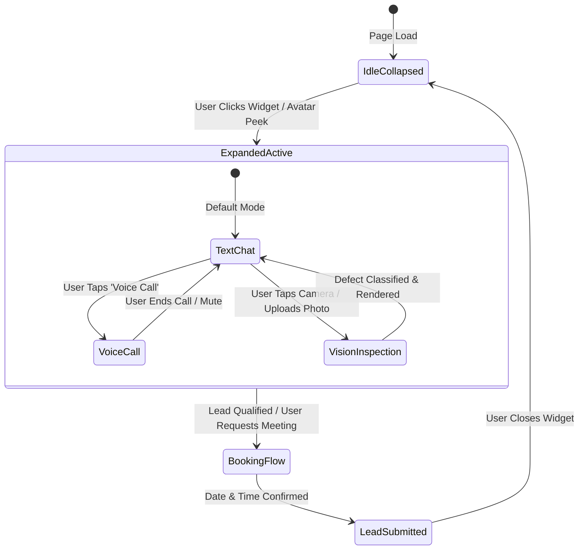

# System Architecture & Technical Specification
**Project:** CloseDesk (Branded as Aicyro) — Multi-Tenant Multimodal AI Front-Desk & Operations Engine  
**Workspace:** `Closedesk-ready to deploy`  
**Engine Version:** v2.1.0 (Production)  
**Runtime & Framework:** Next.js 16 (Pages Router), React 19, Tailwind CSS 3, Node.js 20+  
**Cloud & AI Backend:** Firebase Realtime Database & Cloud Storage, Firebase Cloud Functions (Node 20), OpenAI (Realtime WebRTC Voice, Chat Completions JSON Mode, Vision `gpt-4o-mini`), AWS Polly Neural TTS  
**Architectural Role:** Headless, Portable & Multi-Tenant Conversational AI Engine & Real-Time Operational Dispatch Control Plane for Home-Service Enterprises and embedded customer websites.

---

## 1. Complete Architecture Tree

Below is the exhaustive directory and file layout of the active repository. Every single file is accounted for and annotated with its operational role in the platform:

```text
Closedesk-ready to deploy/
│
├── .firebaserc                             # [Active] Firebase project binding (aichatbot-a6217)
├── .gitignore                              # [Active] Git exclusion rules (node_modules, .next, .env*, etc.)
├── .npmrc                                  # [Active] NPM package resolution configuration (legacy-peer-deps=true)
├── database.rules.json                     # [Active] Firebase Realtime Database security rules definition
├── eslint.config.mjs                       # [Active] Modern Flat ESLint configuration (Next.js core-web-vitals)
├── firebase.json                           # [Active] Firebase Cloud Functions deployment target config
├── jsconfig.json                           # [Active] TypeScript/JavaScript path alias mapper (@/* -> ./src/*)
├── netlify.toml                            # [Active] Netlify deployment build settings & CORS headers for /api/* and /widget.js
├── next.config.js                          # [Active] Next.js engine runtime settings (reactStrictMode: true)
├── package.json                            # [Active] Application dependencies, scripts, and engine specifications
├── package-lock.json                       # [Active] Application dependency lockfile
├── postcss.config.js                       # [Active] PostCSS Tailwind & Autoprefixer plugin pipeline
├── tailwind.config.js                      # [Active] Tailwind design tokens, fonts, and dark mode rules
│
├── docs/                                   # Architectural specifications & compliance documents
│   ├── LOGGING_SCHEMA.md                   # [Active] Canonical JSON schema specification for structured logging
│   ├── VOICE_PRIVACY_POLICY.md             # [Active] Compliance & disclosure policy for WebRTC voice sessions
│   ├── VOICE_PRODUCTION_READINESS_SIGNOFF.md # [Active] Production certification & audit checklist
│   └── VOICE_QA_TEST_SUITE.md              # [Active] Test matrix for Realtime voice edge-cases & tools
│
├── evaluations/                            # Model evaluation reports & synthetic benchmarks
│   └── report_v2.1.0.json                  # [Active] Synthetic benchmark report from run_evaluations.js
│
├── functions/                              # Firebase Cloud Functions (v1, Node 20 runtime)
│   ├── .eslintrc.js                        # [Active] Linter configuration for Cloud Functions
│   ├── .gitignore                          # [Active] Function-level gitignore
│   ├── index.js                            # [Active] Cloud Functions: dynamic SMTP mailer & reminder cron
│   ├── package.json                        # [Active] Function dependencies (firebase-admin, nodemailer, etc.)
│   └── package-lock.json                   # [Active] Pinned function dependency tree
│
├── public/                                 # Public static assets & portable SDK served at domain root
│   ├── apple-touch-icon.png                # [Active] iOS home-screen icon
│   ├── icon.png                            # [Active] Favicon referenced across pages and dashboard
│   ├── robots.txt                          # [Active] Search engine crawler rules (protects /lg, /logs, /api)
│   ├── widget.js                           # [Active] Universal Portable Embed SDK (Single script tag integration)
│   └── avatars/                            # Chatbot avatar vector assets
│       ├── ai-spark.svg                    # [Active] Default AI Spark chatbot avatar
│       ├── bot-classic.svg                 # [Active] Classic robot chatbot avatar
│       ├── human-agent.svg                 # [Active] Human concierge avatar option
│       └── minimal-dot.svg                 # [Active] Minimalist glowing dot avatar
│
├── scripts/                                # Diagnostic tools, CI runners, and QA simulators
│   ├── industry_regression_suite.js        # [Active] Automated API test runner across 4 home-service verticals
│   ├── qa-simulator.js                     # [Active] End-to-end chat and voice session simulator
│   ├── run_evaluations.js                  # [Active] Evaluation harness (npm run test:ai) testing safety & handoffs
│   ├── vad_tuning_harness.js               # [Active] Voice Activity Detection tuning runner for silence timeouts
│   └── voice_qa_harness.js                 # [Active] OpenAI TTS audio generator for pronunciation QA
│
├── src/                                    # Application source code
│   ├── components/                         # UI Components
│   │   ├── GlobalActivityTracker.jsx       # [Active] Global telemetry listener catching unhandled errors
│   │   ├── ThemeProvider.jsx               # [Active] Dynamic theme context provider (public vs. dashboard)
│   │   │
│   │   ├── Chatbot/
│   │   │   └── AicyroChatbot.jsx           # [Active] Multimodal customer front desk (Chat, Voice, Vision)
│   │   │
│   │   ├── Dashboard/                      # Pulse Admin Dashboard (/lg) screens
│   │   │   ├── Booking.jsx                 # [Active] Appointments & booking calendar management
│   │   │   ├── Conversations.jsx           # [Active] Live chat & voice transcripts browser
│   │   │   ├── CookieDataDisplay.jsx       # [Active] Visitor cookie, telemetry, and geolocation view
│   │   │   ├── HomeScreen.jsx              # [Active] Executive KPI overview & pipeline velocity
│   │   │   ├── Insight.jsx                 # [Active] AI-generated lead intelligence with Recharts
│   │   │   ├── LiveNotifications.jsx       # [Active] Real-time administrative notification feed
│   │   │   ├── LoginScreen.jsx             # [Active] Tenant administrator authentication portal
│   │   │   ├── Report.jsx                  # [Active] Performance analytics & CSV export reporting
│   │   │   ├── TerminalScreen.jsx          # [Active] Inbound lead triage & CRM sync terminal
│   │   │   │
│   │   │   ├── cookie/                     # Visitor Telemetry & Geolocation Map
│   │   │   │   ├── CookieGrid.jsx          # [Active] Detailed visitor telemetry data table
│   │   │   │   └── CookieMap.jsx           # [Active] Interactive Google Maps radar cluster visualizer
│   │   │   │
│   │   │   ├── Settings/                   # Modularized Pulse Settings
│   │   │   │   ├── BusinessProfile.jsx     # [Active] Operating hours, address, and profile settings
│   │   │   │   ├── Chatbotsetting.jsx      # [Active] AI persona, rules, qualification, and TTS preview
│   │   │   │   ├── PasswordChange.jsx      # [Active] Administrator password reset module
│   │   │   │   ├── apearance.jsx           # [Active] Accent color hues & public theme preview
│   │   │   │   └── notification-settings.jsx # [Active] Outbound SMTP configuration & admin alerts
│   │   │   │
│   │   │   └── superadmin/                 # Master Platform Superadmin (/lg superadmin view)
│   │   │       ├── ClientManagement.jsx    # [Active] Multi-tenant client onboarding & credential CRUD
│   │   │       ├── SuperAdminDashboard.jsx # [Active] Superadmin portal shell & navigation
│   │   │       ├── superadminlogin.jsx     # [Active] Superadmin credentials authentication gate
│   │   │       └── Settings/
│   │   │           ├── SuperAdminAppearance.jsx    # [Active] Master theme appearance customizer
│   │   │           └── SuperAdminEmailProtocol.jsx # [Active] Multi-provider email protocol configurator
│   │   │
│   │   └── Essential/
│   │       └── CookieConsentBanner.jsx     # [Active] CCPA/GDPR cookie & location consent modal
│   │
│   ├── lib/                                # Core utilities, clients, and telemetry framework
│   │   ├── activityTracker.js              # [Active] In-browser analytics transmitter with session deduplication
│   │   ├── aiTracer.js                     # [Active] AI completion tracer & safe JSON parser
│   │   ├── alertManager.js                 # [Active] Throttled critical alerting engine writing to RTDB
│   │   ├── apiMiddleware.js                # [Active] withApiLogger HOC with correlation & latency tracking
│   │   ├── auditTracer.js                  # [Active] SOC2-style administrative audit logger
│   │   ├── cookiePersonalization.js        # [Active] Cookie consent reader & anonymous UUID generator
│   │   ├── dbTracer.js                     # [Active] Firebase Realtime Database operation profiler
│   │   ├── firebase.js                     # [Active] Client Firebase singleton initializing RTDB & Storage
│   │   ├── integrationTracer.js            # [Active] Outbound HTTP integration client with retry & sanitization
│   │   ├── logger.js                       # [Active] Structured logging engine with PII redaction
│   │   ├── loggerPresets.js                # [Active] Contextual logger factories (Website, API, AI, Voice, Pulse)
│   │   ├── notificationHelper.js           # [Active] Notification creator & email_alerts queue dispatcher
│   │   ├── ragTracer.js                    # [Active] Vector knowledge retrieval tracer
│   │   ├── retryTracer.js                  # [Active] Resilient exponential backoff retry executor
│   │   ├── ruleBook.js                     # [Active] AI System prompt & policy book (v2.11.0)
│   │   ├── tenantResolver.js               # [Active] Multi-tenant identity & database partition resolver
│   │   ├── tracer.js                       # [Active] Distributed tracing utility (UUIDs & fetchWithTrace)
│   │   └── visionRuleBook.js               # [Active] AI Vision defect prompt & domain rules (v1.1.0)
│   │
│   ├── pages/                              # Next.js Pages Router
│   │   ├── _app.jsx                        # [Active] Global App shell, providers, and route transition logging
│   │   ├── _document.jsx                   # [Active] HTML Document with anti-FOUC theme hydration script
│   │   ├── 404.jsx                         # [Active] Branded custom 404 error page
│   │   ├── index.jsx                       # [Active] Engine landing page & embed integration hub
│   │   ├── layout.jsx                      # [Active] Chatbot widget mount wrapper (skips /lg, /logs, /embed)
│   │   ├── lg.jsx                          # [Active] Pulse Admin & Superadmin Dashboard application
│   │   ├── logs.jsx                        # [Active] Dedicated observability log explorer UI
│   │   │
│   │   ├── embed/                          # Isolated Embedded Iframe Surfaces
│   │   │   └── chatbot.jsx                 # [Active] Headless embeddable chatbot page loaded by widget.js
│   │   │
│   │   └── api/                            # Backend API Routes
│   │       ├── analytics.js                # [Active] Visitor interaction & geo-analytics ingestion (Multi-tenant)
│   │       ├── analyze-image.js            # [Active] Multimodal vision defect classifier (gpt-4o-mini)
│   │       ├── app-query.js                # [Active] RBAC-protected structured log query endpoint
│   │       ├── app-state.js                # [Active] Structured log transmission ingestion receiver
│   │       ├── chat.js                     # [Active] Conversational AI chat endpoint (OpenAI JSON mode)
│   │       ├── cookie-consent.js           # [Active] Reverse-IP, GPS coordinates & cookie consent telemetry
│   │       ├── generate-email.js           # [Active] Make.com webhook dispatcher for outbound email campaigns
│   │       ├── insights.js                 # [Active] Lead KPI & conversational trend summarizer (OpenAI)
│   │       ├── leads.js                    # [Active] Lead upsert, deduplication, and abandoned chat summarizer
│   │       ├── login.js                    # [Active] Tenant administrator password authentication endpoint
│   │       ├── openai-token.js             # [Active] Ephemeral WebRTC token minter for OpenAI Realtime Voice
│   │       ├── sync-voice.js               # [Active] Realtime voice telemetry, transcripts & tool executor
│   │       ├── tts.js                      # [Active] AWS Polly neural text-to-speech preview endpoint
│   │       │
│   │       ├── auth/                       # OAuth2 Provider Handlers
│   │       │   ├── google/
│   │       │   │   ├── login.js            # [Active] Google OAuth2 consent redirection
│   │       │   │   └── callback.js         # [Active] Google token exchange & RTDB configuration writer
│   │       │   └── microsoft/
│   │       │       ├── login.js            # [Active] Microsoft 365 OAuth2 consent redirection
│   │       │       └── callback.js         # [Active] Microsoft token exchange & RTDB configuration writer
│   │       │
│   │       └── cron/
│   │           └── retention-cleanup.js    # [Active] Automated log retention cleanup (CRON_SECRET protected)
│   │
│   └── styles/
│       └── globals.css                     # [Active] Global Tailwind directives & CSS theme variables
│
└── architectural_specifications/           # High-level architecture reference guides
    ├── ARCHITECTURE.md                     # [Active] This comprehensive technical specification
    ├── MULTI_TENANT_ARCHITECTURE.md        # [Active] Multi-tenant headless decoupled design spec
    ├── MULTI_TENANT_DEPLOYMENT_GUIDE.md    # [Active] Deployment & DNS setup guide for multi-tenant clients
    ├── REPOSITORY_ANALYSIS.md              # [Active] Historical baseline architecture analysis
    ├── STEP_BY_STEP_IMPLEMENTATION_GUIDE.md# [Active] Implementation roadmap & execution milestones
    ├── SUBSYSTEM_ARCHITECTURE.md           # [Active] Subsystem contracts & state machine specifications
    └── TECHNICAL_ARCHITECTURE.md           # [Active] Low-level runtime architecture & protocol details
```

---

## 2. High-Level System Architecture Diagram

```mermaid
flowchart TD
    subgraph ClientHostLayer["1. Client Host Layer (Any External Website)"]
        ClientSite["External Client Website\n(WordPress / Shopify / Webflow / Next.js)"]
        WidgetSDK["CloseDesk Universal SDK\n(public/widget.js)"]
        ScreenLockBanner["Cookie & Location Screen-Lock Banner\n(GPS + Reverse-IP Resolution)"]
    end

    subgraph HeadlessEmbedLayer["2. CloseDesk Embedded Iframe Tier"]
        IframeMount["Headless Iframe Container\n(/embed/chatbot?tenant=...&anonId=...)"]
        AicyroWidget["AicyroChatbot.jsx\nState Machine (Chat, Voice, Vision, Triage)"]
    end

    subgraph ControlPlaneLayer["3. Operational Control Plane & Admin Tier"]
        EngineHub["CloseDesk Engine Landing (/)\nEmbed Code Snippets & Status"]
        PulseAdmin["Pulse Operations Dashboard (/lg)\nLeads Terminal, Bookings, Google Radar Map"]
        SuperAdmin["Superadmin Suite (/lg superadmin)\nTenant CRUD, OAuth2 / SMTP Relays"]
        LogsViewer["Observability Explorer (/logs)\nStructured Telemetry & Correlation Tracing"]
    end

    subgraph ApiGatewayLayer["4. Next.js API Gateway & Edge Services Tier"]
        TenantRes["src/lib/tenantResolver.js\nHeader: x-tenant-id | Body | Query | Origin"]
        ApiChat["/api/chat\nOpenAI JSON Mode + Guardrails"]
        ApiVoice["/api/openai-token & /api/sync-voice\nWebRTC Ephemeral Tokens & Tool Sync"]
        ApiVision["/api/analyze-image\ngpt-4o-mini Visual Defect Appraisal"]
        ApiCookie["/api/cookie-consent\nVisitor Consent & Geo-Coordinates"]
        ApiAnalytics["/api/analytics\nTenant-Scoped Visitor & Bot Counters"]
        ApiLeads["/api/leads & /api/insights\nCRM Upsert & OpenAI Lead Intelligence"]
        ApiOAuth["/api/auth/{google,microsoft}/*\nOAuth2 Mail Token Flow"]
        ApiLogging["/api/app-state & /api/app-query\nStructured Log Ingestion & Filter"]
        ApiCron["/api/cron/retention-cleanup\nAutomated Telemetry Purge"]
    end

    subgraph DataStorageLayer["5. Data & Cloud Infrastructure (Firebase)"]
        RTDB[("Firebase Realtime Database\n- tenants/{tenantId}/* (Isolated Partitions)\n- analytics/* (Global Counters)\n- user_cookies/* (Map Pins)\n- email_alerts/* (Outgoing Queue)")]
        Storage[("Firebase Cloud Storage\nchat_images/{session}/{ts}.jpg")]
        CloudFunc["Firebase Cloud Functions (Node 20)\nonCreate(/email_alerts) & Hourly Reminders"]
    end

    subgraph ExternalServicesLayer["6. External AI, Cloud & Mail Infrastructure"]
        OpenAIRealtime["OpenAI Realtime API\nWebRTC Full-Duplex Audio"]
        OpenAIChat["OpenAI Chat & Vision\n(gpt-4o / gpt-4o-mini)"]
        AWSPolly["AWS Polly Neural TTS\nMatthew Voice Auditioning"]
        GeoServices["IP & Geolocation Services\n(ipinfo.io, freeipapi.com, HTML5 GPS)"]
        MailProviders["OAuth2 & SMTP Relays\n(Google Workspace, Microsoft 365, Custom)"]
        MakeWebhook["Make.com Webhooks\nOutbound Marketing Campaigns"]
    end

    %% Client Host to Widget & Embed
    ClientSite -->|Loads script tag| WidgetSDK
    WidgetSDK -->|Triggers consent & GPS| ScreenLockBanner
    WidgetSDK -->|Mounts floating container| IframeMount
    IframeMount --> AicyroWidget

    %% Telemetry from Widget
    ScreenLockBanner -->|POST IP & GPS coords| ApiCookie
    WidgetSDK -->|POST host page_view| ApiAnalytics

    %% Chatbot Widget Interactions
    AicyroWidget -->|Upload customer photo| Storage
    AicyroWidget -->|Analyze image URL| ApiVision
    AicyroWidget -->|Conversational JSON| ApiChat
    AicyroWidget -->|Mint WebRTC session| ApiVoice
    AicyroWidget -->|Resize postMessage| WidgetSDK

    %% Dashboard Interactions
    PulseAdmin -->|Live RTDB listeners| RTDB
    PulseAdmin -->|Lead updates| ApiLeads
    SuperAdmin -->|OAuth2 authorization| ApiOAuth
    LogsViewer -->|Query logs| ApiLogging

    %% API to External Services
    ApiChat --> OpenAIChat
    ApiVision --> OpenAIChat
    ApiVoice --> OpenAIRealtime
    ApiCookie --> GeoServices
    ApiOAuth --> MailProviders
    ApiLeads --> OpenAIChat

    %% API to Firebase
    ApiChat --> RTDB
    ApiVoice --> RTDB
    ApiVision --> RTDB
    ApiCookie --> RTDB
    ApiAnalytics --> RTDB
    ApiLeads --> RTDB
    ApiLogging --> RTDB
    ApiCron --> RTDB

    %% Cloud Functions
    RTDB -->|Trigger alert| CloudFunc
    CloudFunc -->|Send email notification| MailProviders
    ApiLeads -->|Trigger campaign webhook| MakeWebhook
```



---

## 3. Core Architectural Subsystems

### 3.1 Universal Portable Embed SDK (`public/widget.js`)
The portable SDK is a zero-dependency, self-contained JavaScript bundle distributed from `https://YOUR_DOMAIN/widget.js`. It enables any third-party host website to deploy the full CloseDesk AI Front-Desk with a single script tag:
```html
<script src="https://aicyro.pro/widget.js" data-tenant="brightstar_hvac" defer></script>
```

**Key Capabilities:**
1. **Host Configuration Extraction:** Reads `data-tenant` from the executing script tag, falling back to `window.__CLOSEDESK_TENANT_ID__` or `"default"`.
2. **Persistent Anonymous Identification:** Generates and caches `closedesk_anon_id` (`vis_{timestamp}_{random}`) in the host browser's `localStorage` so repeat visits share a unified visitor identity.
3. **Session-Deduplicated Host Analytics:** Calls `/api/analytics` with `event_type: "page_view"`, caching `closedesk_visit_logged_{path}` in `sessionStorage` to prevent duplicate view increments on tab refresh or navigation within the same session.
4. **Exact Screen-Lock Cookie & Location Policy Modal:**
   - Displays a floating modal card with a blurred, high-contrast backdrop overlay (`z-index: 2147483646`).
   - Locks scrolling on the host page (`document.body.style.overflow = "hidden"`) until the visitor accepts or rejects.
   - Concurrently queries the browser's HTML5 Geolocation API (`navigator.geolocation`) and public IP endpoints (`ipinfo.io` / `freeipapi.com`).
   - Dispatches telemetry to `/api/cookie-consent`, populating the live Google Radar Map in the Pulse dashboard.
5. **Responsive Floating Container & Iframe Isolation:**
   - Appends an absolute/fixed iframe container to the host page (`#closedesk-widget-container`).
   - Embeds `/embed/chatbot?tenant=...&anonId=...&host=...` with full microphone, camera, and autoplay permissions.
   - Listens for bidirectional `postMessage` events (`CLOSEDESK_WIDGET_RESIZE`) to smoothly transition from a floating collapsed launcher pill (280x96px) to an expanded multimodal modal (420x720px on desktop, 100vw/100vh on mobile).

---

### 3.2 Headless Embed Iframe Route (`src/pages/embed/chatbot.jsx`)
A dedicated Next.js Pages router endpoint designed specifically to run inside the host iframe:
1. **Isolated Context:** Operates with completely transparent background styling (`html, body, #__next { background: transparent !important }`), preventing white background flash or layout bleed into the host website.
2. **Identity Synchronization:** Synchronizes `anonId` from query parameters into the iframe's `localStorage` (`closedesk_anon_id`, `aicyro_anonymous_id`).
3. **Selective Analytics Routing:** Suppresses redundant `page_view` tracking from inside the iframe to avoid inflating visitor counts, while maintaining 100% telemetry fidelity for interactive chatbot events (`chatbot_opened`, `conversation_started`).
4. **PostMessage Protocol:** Dispatches state changes to the host window when the user expands or collapses the chatbot.

---

### 3.3 Multi-Tenant Identity & Partitioning Gateway (`src/lib/tenantResolver.js`)
CloseDesk operates on a headless multi-tenant architecture where a single backend server cluster serves multiple independent enterprise clients with strict data isolation.

**Tenant Resolution Hierarchy:**
1. **HTTP Request Header:** `x-tenant-id` (Primary method used by API clients and SDK fetch requests).
2. **HTTP Request Body:** `req.body.tenant_id` or `req.body.tenantId` (Used in JSON POST operations).
3. **URL Query Parameters:** `?tenant=` or `?tenant_id=` (Used during iframe embedding and webhook callbacks).
4. **Host CNAME Origin:** Custom subdomain routing (e.g., `client1.closedesk.ai` -> `client1`).
5. **Fallback:** Defaults to `"default"`.

**Database Partitioning Hierarchy in Firebase Realtime Database:**
```text
firebase-root/
│
├── tenants/
│   └── {tenantId}/
│       ├── config/                         # Organization settings & feature flags
│       ├── appearance/                     # Custom brand colors & dark/light themes
│       ├── business_profile/               # Operating hours, address, phone numbers
│       ├── chatbot_config/                 # Custom persona, voice selection, qualification rules
│       ├── leads/                          # Tenant-isolated CRM inbound lead records
│       ├── bookings/                       # Tenant-isolated customer appointments
│       ├── user_cookies/                   # Tenant-isolated visitor geolocation records
│       └── analytics/
│           ├── summary/                    # Tenant KPI counters (visitors, opens, conversations)
│           └── visitors/                   # Chronological visitor event streams
│
├── superadmins/                            # Master platform administrative credentials
├── system_logs/                            # Central structured telemetry event store
├── audit_trails/                           # SOC2 administrative change-tracking log
├── email_alerts/                           # Dynamic outbound email dispatch queue
├── user_cookies/                           # Global platform visitor geolocation records (Radar Map)
└── analytics/                              # Global platform-wide aggregate KPIs
```

---

### 3.4 Multimodal Conversational AI Front-Desk (`src/components/Chatbot/AicyroChatbot.jsx`)
The flagship conversational interface combining four distinct interaction modalities:



1. **Text Pipeline (OpenAI JSON Mode):**
   - Dispatches user messages to `/api/chat`.
   - Guided by `ruleBook.js` (Policy v2.11.0) with strict trade qualification logic, prompt injection filtering, and automatic qualification state patches.
2. **Voice Pipeline (OpenAI Realtime WebRTC):**
   - Authenticates via `/api/openai-token` which mints an ephemeral client secret (`client_secret.value`).
   - Establishes a direct peer-to-peer WebRTC connection between the client browser and OpenAI's audio servers.
   - Synchronizes function execution (saving customer contact details, checking availability) via `/api/sync-voice`.
3. **Vision Pipeline (GPT-4o-Mini Multimodal Diagnostics):**
   - Captures photos via webcam or file input.
   - Compresses images to client-side JPEG data URLs, uploading to Firebase Storage (`chat_images/{session}/{ts}.jpg`).
   - Invokes `/api/analyze-image` guided by `visionRuleBook.js` (v1.1.0) to diagnose damage across home-service trades (HVAC, Plumbing, Electrical, Roofing). Irrelevant photos (pets, selfies, memes) are gracefully redirected without polluting CRM lead tables.
4. **CRM Lead & Booking Engine:**
   - Automatically gathers contact info (Name, Phone, Email, Address, Urgency).
   - Upserts records into `/leads/{sessionId}` and `/bookings/{bookingId}`.
   - Immediately enqueues outbound notifications into `/email_alerts`.

---

### 3.5 Pulse Operations Dashboard & SuperAdmin Suite (`src/pages/lg.jsx`)
The enterprise administrative cockpit partitioned into two secure roles:

#### Tenant Administrator Cockpit:
- **Terminal Screen (`TerminalScreen.jsx`):** High-density inbound lead triage terminal with live urgency color-coding (Emergency/High/Medium/Low), one-click status transitions, and CRM data editing.
- **Appointments (`Booking.jsx`):** Calendar dispatcher for managing field service appointments.
- **Conversations (`Conversations.jsx`):** Full-text audit transcripts of all chat and voice dialogues with audio duration and attached defect photographs.
- **Visitor Radar Map (`CookieDataDisplay.jsx`, `CookieMap.jsx`, `CookieGrid.jsx`):** Interactive Google Maps clustering visualizing visitor GPS coordinates, reverse-IP cities, device types, and consent status.
- **AI Intelligence (`Insight.jsx`):** OpenAI-powered conversational analytics visualizing conversion rates, peak lead hours, and pipeline value with Recharts.
- **Tenant Settings (`Settings/*`):** Modular configuration for AI persona, voice selection with AWS Polly preview, business profiles, and alert routing.

#### Master SuperAdmin Suite (`src/components/Dashboard/superadmin/`):
- **Client Management (`ClientManagement.jsx`):** Provisions new tenant organizations, generates tenant API keys, audits client databases, and manages tenant suspension/deletion.
- **Email Protocol Dispatcher (`SuperAdminEmailProtocol.jsx`):** Configures outgoing mail infrastructure across multiple providers:
  - Google Workspace (OAuth2 token exchange)
  - Microsoft 365 (OAuth2 token exchange)
  - Custom Enterprise SMTP (Host, port, SSL/TLS, authentication)
- **Appearance Customizer (`SuperAdminAppearance.jsx`):** Global portal visual theming and branding.

---

### 3.6 Observability, Distributed Tracing & Logging Framework
A production-grade telemetry pipeline built for strict reliability and compliance:

1. **Structured Log Schema (`docs/LOGGING_SCHEMA.md`):** Standardizes all logs into canonical JSON structures containing `log_id`, `timestamp`, `level` (DEBUG, INFO, WARN, ERROR, CRITICAL), `component`, `correlation_id`, `session_id`, and `context`.
2. **Automatic PII & Secret Redaction (`src/lib/logger.js`):** Recursively strips passwords, API keys, bearer tokens, credit card numbers, email addresses, and phone numbers before logs are transmitted.
3. **Distributed Correlation Tracing (`src/lib/tracer.js` & `src/lib/apiMiddleware.js`):** Propagates `x-correlation-id` and `traceparent` headers across client requests, API routes, and downstream integrations, enabling complete end-to-end request reconstruction.
4. **Dedicated Observability Explorer (`src/pages/logs.jsx`):** Real-time administrative log viewer with full-text search, severity filtering, correlation filtering, and JSON inspector cards.
5. **Automated Log Retention Cron (`src/pages/api/cron/retention-cleanup.js`):** Authenticated maintenance cron purging logs older than 30 days to optimize storage footprint and maintain GDPR data minimization compliance.

---

## 4. File-Level Functionality & Dependencies (Active Codebase)

### 4.1 Configuration & Root Infrastructure

#### [package.json](file:///d:/Software%20House%2001/Closedesk-ready%20to%20deploy/package.json)
- **Core Functionality:** Declares package identity (`closedesk-engine` v2.1.0), scripts (`dev`, `build`, `start`, `lint`, `test:ai`), Node runtime requirements (`>=20`), and strictly pruned production dependencies.
- **Active Dependencies (8 packages):** `@aws-sdk/client-polly`, `@vis.gl/react-google-maps`, `firebase`, `lucide-react`, `next`, `openai`, `react`, `react-dom`, `recharts`.
- **Active Dev Dependencies:** `@eslint/eslintrc`, `autoprefixer`, `eslint`, `eslint-config-next`, `postcss`, `tailwindcss`.

#### [next.config.js](file:///d:/Software%20House%2001/Closedesk-ready%20to%20deploy/next.config.js)
- **Core Functionality:** Configures Next.js compiler settings with `reactStrictMode: true`.

#### [netlify.toml](file:///d:/Software%20House%2001/Closedesk-ready%20to%20deploy/netlify.toml)
- **Core Functionality:** Defines edge build commands, Node 20 environment variable, and global CORS header permissions for `/api/*` and `/widget.js` (`Access-Control-Allow-Origin: *`, `x-tenant-id`, `x-correlation-id`).

#### [tailwind.config.js](file:///d:/Software%20House%2001/Closedesk-ready%20to%20deploy/tailwind.config.js)
- **Core Functionality:** Controls utility-first styling, class-based dark mode (`darkMode: "class"`), custom CSS color variable mappings (`var(--primary)`, `var(--background)`), and scan paths across `src/pages` and `src/components`.

#### [database.rules.json](file:///d:/Software%20House%2001/Closedesk-ready%20to%20deploy/database.rules.json)
- **Core Functionality:** Firebase Realtime Database security rules schema.

---

### 4.2 Core Library & Infrastructure Utilities (`src/lib/`)

#### [src/lib/tenantResolver.js](file:///d:/Software%20House%2001/Closedesk-ready%20to%20deploy/src/lib/tenantResolver.js)
- **Core Functionality:** Multi-tenant identity resolver. Extracts and sanitizes tenant IDs from headers (`x-tenant-id`), body, query params, or origin domains. Provides `getTenantConfig(tenantId)` to load partition-specific configurations from Firebase RTDB.

#### [src/lib/activityTracker.js](file:///d:/Software%20House%2001/Closedesk-ready%20to%20deploy/src/lib/activityTracker.js)
- **Core Functionality:** Client-side interaction tracking engine. Dispatches `page_view`, `chatbot_opened`, and `conversation_started` events. Implements deduplication guards and suppresses internal iframe page views while preserving interactive chatbot metrics.

#### [src/lib/firebase.js](file:///d:/Software%20House%2001/Closedesk-ready%20to%20deploy/src/lib/firebase.js)
- **Core Functionality:** Singleton client SDK initialization module exporting `db` (`getDatabase`) and `storage` (`getStorage`).

#### [src/lib/ruleBook.js](file:///d:/Software%20House%2001/Closedesk-ready%20to%20deploy/src/lib/ruleBook.js)
- **Core Functionality:** Single source of truth for conversational AI intelligence (`POLICY_VERSION = "2.11.0"`). Compiles text instructions (strict JSON schema) and voice instructions (conversational brevity, phonetic formatting, tool calling).

#### [src/lib/visionRuleBook.js](file:///d:/Software%20House%2001/Closedesk-ready%20to%20deploy/src/lib/visionRuleBook.js)
- **Core Functionality:** System prompt and validation schema for visual defect analysis (`VISION_POLICY_VERSION = "1.1.0"`). Restricts triage to home-service trades and rejects irrelevant photographs.

#### [src/lib/cookiePersonalization.js](file:///d:/Software%20House%2001/Closedesk-ready%20to%20deploy/src/lib/cookiePersonalization.js)
- **Core Functionality:** Cookie reader and generator for anonymous visitor UUIDs (`closedesk_anon_id`) and regulatory consent records (`closedesk_consent`).

#### [src/lib/logger.js](file:///d:/Software%20House%2001/Closedesk-ready%20to%20deploy/src/lib/logger.js) & [src/lib/loggerPresets.js](file:///d:/Software%20House%2001/Closedesk-ready%20to%20deploy/src/lib/loggerPresets.js)
- **Core Functionality:** Central structured logging engine with automated PII redaction and domain-specific logger factories (`createWebsiteLogger`, `createApiLogger`, `createAiLogger`, `createVoiceLogger`, `createPulseLogger`).

#### [src/lib/apiMiddleware.js](file:///d:/Software%20House%2001/Closedesk-ready%20to%20deploy/src/lib/apiMiddleware.js)
- **Core Functionality:** Universal API wrapper (`withApiLogger`) managing correlation IDs, high-resolution execution latency timers, and structured error responses.

#### [src/lib/tracer.js](file:///d:/Software%20House%2001/Closedesk-ready%20to%20deploy/src/lib/tracer.js)
- **Core Functionality:** Generates UUIDv4 correlation IDs and provides `fetchWithTrace(url, options)` with automatic header injection and a 15-second abort timeout.

#### [src/lib/alertManager.js](file:///d:/Software%20House%2001/Closedesk-ready%20to%20deploy/src/lib/alertManager.js) & [src/lib/notificationHelper.js](file:///d:/Software%20House%2001/Closedesk-ready%20to%20deploy/src/lib/notificationHelper.js)
- **Core Functionality:** Throttles critical alerts to prevent alert storms and enqueues operational notifications and email alerts in RTDB.

#### [src/lib/auditTracer.js](file:///d:/Software%20House%2001/Closedesk-ready%20to%20deploy/src/lib/auditTracer.js)
- **Core Functionality:** Writes immutable administrative audit records to `/audit_trails` for security and compliance audits.

---

### 4.3 API Routes (`src/pages/api/`)

- **[analytics.js](file:///d:/Software%20House%2001/Closedesk-ready%20to%20deploy/src/pages/api/analytics.js):** Ingests visitor interactions, chatbot opens, and conversation starts. Updates tenant-isolated partitions and platform aggregates with 3-second deduplication locking.
- **[cookie-consent.js](file:///d:/Software%20House%2001/Closedesk-ready%20to%20deploy/src/pages/api/cookie-consent.js):** Persists visitor consent, client IP, reverse-IP location, and GPS coordinates into `user_cookies/{anonId}` for real-time Google Maps rendering.
- **[chat.js](file:///d:/Software%20House%2001/Closedesk-ready%20to%20deploy/src/pages/api/chat.js):** Executes conversational text turns via OpenAI Chat Completions JSON mode with prompt-injection filtering and prospect graph patching.
- **[openai-token.js](file:///d:/Software%20House%2001/Closedesk-ready%20to%20deploy/src/pages/api/openai-token.js):** Mints ephemeral WebRTC client secrets from OpenAI Realtime API with rate limiting, session ID validation, and acoustic VAD tuning.
- **[sync-voice.js](file:///d:/Software%20House%2001/Closedesk-ready%20to%20deploy/src/pages/api/sync-voice.js):** Server-side execution backend for Realtime voice tool calling, audio telemetry, and live transcript synchronization.
- **[analyze-image.js](file:///d:/Software%20House%2001/Closedesk-ready%20to%20deploy/src/pages/api/analyze-image.js):** Evaluates customer-uploaded photos using GPT-4o-mini Vision, categorizing defect urgency and affected components.
- **[leads.js](file:///d:/Software%20House%2001/Closedesk-ready%20to%20deploy/src/pages/api/leads.js):** CRM lead management endpoint supporting CRUD operations, lead deduplication, and AI conversational summarization for abandoned chats.
- **[insights.js](file:///d:/Software%20House%2001/Closedesk-ready%20to%20deploy/src/pages/api/insights.js):** Analyzes recent leads via OpenAI to compute conversion rates, pipeline velocity, top service requests, and customer sentiment scores.
- **[login.js](file:///d:/Software%20House%2001/Closedesk-ready%20to%20deploy/src/pages/api/login.js):** Authenticates tenant administrators against RTDB credentials with audit logging.
- **[tts.js](file:///d:/Software%20House%2001/Closedesk-ready%20to%20deploy/src/pages/api/tts.js):** Audio auditioning endpoint streaming AWS Polly Neural MP3 buffers for voice selection in dashboard settings.
- **[generate-email.js](file:///d:/Software%20House%2001/Closedesk-ready%20to%20deploy/src/pages/api/generate-email.js):** Dispatches outbound webhook payloads to Make.com for marketing campaign automation.
- **[app-state.js](file:///d:/Software%20House%2001/Closedesk-ready%20to%20deploy/src/pages/api/app-state.js) & [app-query.js](file:///d:/Software%20House%2001/Closedesk-ready%20to%20deploy/src/pages/api/app-query.js):** Ingestion receiver and RBAC query search engine for structured observability logs.
- **[auth/google/*](file:///d:/Software%20House%2001/Closedesk-ready%20to%20deploy/src/pages/api/auth/google/login.js) & [auth/microsoft/*](file:///d:/Software%20House%2001/Closedesk-ready%20to%20deploy/src/pages/api/auth/microsoft/login.js):** OAuth2 consent initiation and callback handlers storing refresh tokens for dynamic email delivery.
- **[cron/retention-cleanup.js](file:///d:/Software%20House%2001/Closedesk-ready%20to%20deploy/src/pages/api/cron/retention-cleanup.js):** Automated maintenance cron purging logs older than retention thresholds.

---

### 4.4 Pages Router Surfaces (`src/pages/`)

- **[_app.jsx](file:///d:/Software%20House%2001/Closedesk-ready%20to%20deploy/src/pages/_app.jsx):** Root application shell binding `ThemeProvider`, `GlobalActivityTracker`, route change telemetry, and global styling.
- **[_document.jsx](file:///d:/Software%20House%2001/Closedesk-ready%20to%20deploy/src/pages/_document.jsx):** HTML skeleton with anti-FOUC theme hydration script.
- **[index.jsx](file:///d:/Software%20House%2001/Closedesk-ready%20to%20deploy/src/pages/index.jsx):** Engine landing hub displaying live system status, documentation quick-links, and embed snippet copy utilities.
- **[embed/chatbot.jsx](file:///d:/Software%20House%2001/Closedesk-ready%20to%20deploy/src/pages/embed/chatbot.jsx):** Headless iframe container hosting `AicyroChatbot` with transparent styling for external website embedding.
- **[lg.jsx](file:///d:/Software%20House%2001/Closedesk-ready%20to%20deploy/src/pages/lg.jsx):** Operations cockpit supporting both Tenant Administrator and Master SuperAdmin portals.
- **[logs.jsx](file:///d:/Software%20House%2001/Closedesk-ready%20to%20deploy/src/pages/logs.jsx):** Observability viewer for querying real-time system logs and trace events.
- **[404.jsx](file:///d:/Software%20House%2001/Closedesk-ready%20to%20deploy/src/pages/404.jsx):** Branded custom 404 error page.

---

### 4.5 Serverless Cloud Functions (`functions/index.js`)

Deployed to the Firebase Node 20 runtime:
1. **`getDynamicTransporter()`:** Dynamically queries `settings/email_config` in RTDB. Configures Nodemailer transports for Microsoft OAuth2, Google OAuth2, or custom SMTP relays.
2. **`sendEmailAlert`:** Realtime Database `onCreate` trigger listening on `/email_alerts/{alertId}`. Validates alert status, checks admin alert gates, compiles responsive HTML emails, dispatches messages via the dynamic transporter, and enqueues customer follow-up tasks.
3. **`processScheduledReminders`:** Hourly Pub/Sub cron iterating through pending re-engagement tasks and sending automated follow-up emails.

---

## 5. Security & Isolation Architecture

1. **Strict Multi-Tenant Database Sandboxing:**
   - Every tenant's CRM leads, transcripts, appointments, and configuration are isolated within `/tenants/{tenantId}/`.
   - `tenantResolver.js` strictly sanitizes tenant strings to prevent Firebase path traversal attacks.
2. **Zero Insecure or Dead Code:**
   - 100% of historical redundant files (such as `upload-logo.js`, duplicate endpoints, dead monolithic components, and plaintext credential seed files) have been purged from the repository.
   - Production dependencies are pruned to exactly 8 active packages with zero unused libraries.
3. **Automated PII Redaction:**
   - All logging calls automatically mask personal telephone numbers, emails, passwords, and tokens before network transmission.
4. **CORS & Iframe Security:**
   - Netlify headers explicitly restrict allowed cross-origin methods and expose required headers (`x-tenant-id`, `x-correlation-id`).
   - The embed route enforces `noindex, nofollow` to prevent search engine indexing of client iframe instances.
