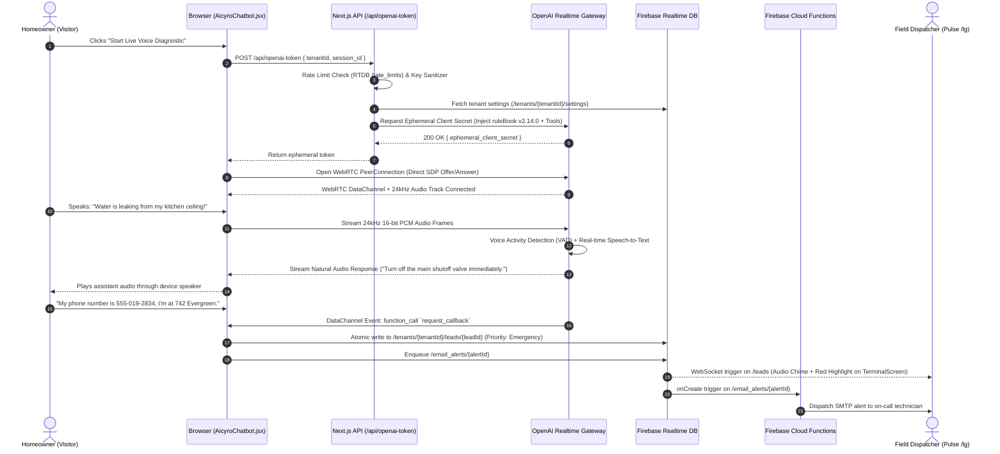
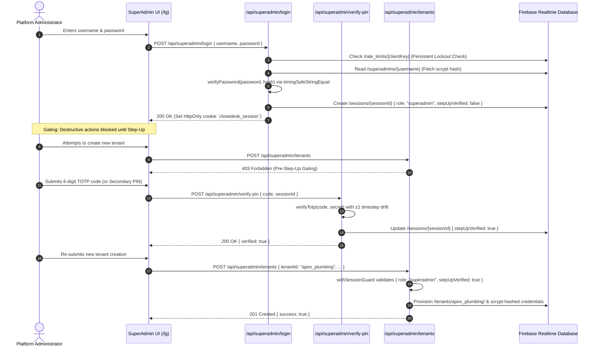

# Technical Architecture Document: CloseDesk (Aicyro)

> **Document Type:** System Architecture Specification & Engineering Reference  
> **Product:** CloseDesk Engine (Branded as Aicyro) | **Version:** `v2.1.0`  
> **Repository:** `closedesk-engine` (formerly `CloseDesk-Aicyro-GIT`)  
> **Target Runtime:** Next.js 16.1.6 (Pages Router, Turbopack), React 19.2.4, Tailwind CSS 3.4.18, Node.js >= 20.x  
> **Cloud & AI Backend:** Firebase Realtime Database & Storage, Firebase Cloud Functions (Node 20), OpenAI (Realtime WebRTC / GPT-4o-mini Vision / Structured JSON), AWS Polly Neural TTS

---

## 1. Sitemap & Routing Architecture

The routing topology enforces strict physical separation between public customer-facing routes, authenticated tenant CRM interfaces, observability explorer surfaces, and serverless backend API microservices.

```text
/ (Domain Root)
│
├── [Public Marketing & Conversion Pages] (SSG / Selective Client Hydration)
│   ├── / .................................... Public Landing Portal (Hero, Feature Matrices, Live Demos)
│   ├── /embed/chatbot ....................... Sandboxed Iframe Route for Embedded Widget Telemetry & Chat
│   ├── /e2e-report .......................... Automated Platform Integration & Test Execution Report
│   └── /404 ................................. Custom Branded Error Boundary & Fallback Navigation
│
├── [Protected Operations & Admin Routes] (Strict Client-Side SPA / Session Gate)
│   ├── /lg .................................. Pulse Multi-Tenant Operations & SuperAdmin Control Plane
│   │   ├── #home ............................ Real-Time KPI Velocity Cockpit, Pipeline & Conversion Metrics
│   │   ├── #terminal ........................ Inbound Lead Triage, Emergency Priority Queue & Dispatch Hub
│   │   ├── #conversations ................... Full Text Transcripts, Sentiment Tags & Defect Photos
│   │   ├── #booking ......................... Interactive Dispatch Calendar & Appointment Status Overrides
│   │   ├── #insight ......................... AI Lead Intelligence, Conversion Trends & Recharts Graphs
│   │   ├── #notifications ................... Reactive Dispatch Alert Feed with Audible Chimes
│   │   ├── #cookie-data ..................... Visitor Geolocation Cluster Maps & Device Fingerprint Grid
│   │   ├── #settings ........................ Tenant AI Persona, Business Profile, Themes & Password Rotation
│   │   └── #superadmin ...................... Multi-Tenant Client Onboarding, Billing & Global System Protocols
│   │
│   └── /logs ................................ Distributed System Observability & Audit Log Explorer
│
└── [Serverless Microservice API Layer] (Next.js Serverless Routes: src/pages/api/)
    ├── /api/chat ............................ Conversational Chat Completion Engine (OpenAI Structured JSON)
    ├── /api/openai-token .................... Ephemeral WebRTC Client Secret Minter with Client Policy Injection
    ├── /api/analyze-image ................... Multimodal Vision Diagnostic Classifier (GPT-4o-mini Vision)
    ├── /api/sync-voice ...................... WebRTC Telemetry, Latency Profiling & Transcript Synchronizer
    ├── /api/tts ............................. Fallback Neural Speech Synthesis (AWS Polly)
    ├── /api/leads ........................... Lead Deduplication, Ingestion & Emergency Scoring
    ├── /api/insights ........................ Executive Business Intelligence & Sentiment Aggregator
    ├── /api/generate-email .................. Outbound CRM Webhook Dispatcher
    ├── /api/login ........................... Tenant Operator Scrypt Authentication & Session Gate
    ├── /api/logout .......................... Server-Side Session Invalidation
    ├── /api/analytics ....................... Visitor Traffic Telemetry & Hardware Spec Ingestion
    ├── /api/cookie-consent .................. Visitor Privacy Preferences & Telemetry Gate
    ├── /api/app-state ....................... Structured Log Transmission Receiver & PII Redactor
    ├── /api/app-query ....................... RBAC-Protected Log Query Engine with Time-Window Filtering
    ├── /api/cron/retention-cleanup .......... Scheduled Compliance Log Retention & Ephemeral Pruning
    │
    ├── /api/auth/google/login ............... Google Calendar OAuth2 Authorization URL Generator
    ├── /api/auth/google/callback ............ Google Calendar OAuth2 Token Exchange & Storage
    ├── /api/auth/microsoft/login ............ Microsoft 365 OAuth2 Authorization URL Generator
    ├── /api/auth/microsoft/callback ......... Microsoft 365 OAuth2 Token Exchange & Storage
    │
    ├── /api/superadmin/login ................ SuperAdmin Primary Scrypt Authentication
    ├── /api/superadmin/logout ............... SuperAdmin Session Revocation
    ├── /api/superadmin/verify-pin ........... Step-Up Authorization (RFC 6238 TOTP, PIN, Recovery Code)
    ├── /api/superadmin/tenants .............. Step-Up Protected Multi-Tenant CRUD Operations
    ├── /api/superadmin/settings ............. Step-Up Protected Global Email Relay Configuration
    └── /api/user/password ................... Scrypt Password Update with Re-Auth & Session Rotation
```

---

## 2. System Architecture

```text
  +---------------------------------------------------------------------------------------------------+
  |                                            CLIENT TIER                                            |
  |                                                                                                   |
  |  +---------------------------------------+     +-----------------------------------------------+  |
  |  |       Public Host Websites            |     |        Pulse Operations Portal (/lg)          |  |
  |  |  (WordPress, Webflow, Shopify, HTML)  |     |  Strict Client-Side Rendering (CSR)           |  |
  |  |  Loads public/widget.js (Zero-Conflict|     |  Signed HMAC-SHA256 Cookie Session + RBAC Gate|  |
  |  +---------------------------------------+     +-----------------------------------------------+  |
  |                      |                                                 |                          |
  |          postMessage | (Resize & Telemetry)                            | HTTPS (Cookies & CSRF)   |
  |                      v                                                 v                          |
  |  +---------------------------------------------------------------------------------------------+  |
  |  |                      Aicyro Multimodal Front-Desk Widget (/embed/chatbot)                   |  |
  |  |  - Audio Capture (16-bit PCM / 24kHz)         - Client Defect Photo Capture & Base64        |  |
  |  |  - WebRTC DataChannel (Tool Invocations)      - Consent Gate (CookieConsentBanner.jsx)      |  |
  |  +---------------------------------------------------------------------------------------------+  |
  +-----------------------------|-----------------------------------|---------------------------------+
                                |                                   |
                HTTPS / REST (withApiLogger)           Direct Realtime WebRTC (sub-100ms)
                                |                                   |
                                v                                   v
  +---------------------------------------------------+     +-----------------------------------------+
  |              APPLICATION GATEWAY TIER             |     |         OPENAI REALTIME GATEWAY         |
  |             (Next.js Serverless Engine)           |     |                                         |
  |                                                   |     |  * Bidirectional Audio Streaming (24kHz)|
  |  * Distributed Tracing (x-correlation-id)         |     |  * Server-Side Voice Activity Detection |
  |  * Key Sanitizer (sanitizeFirebaseKey)            |     |  * Real-Time Speech-to-Text & Tool Calls|
  |  * Persistent Rate Limiting (RTDB Sliding Window) |     +-----------------------------------------+
  |  * Privileged Access & Session Guard (CD02):      |
  |      - Salted Scrypt Hashing (N=16384, r=8, p=1)  |
  |      - Signed HMAC-SHA256 Session Verification    |
  |      - Step-Up Authorization (TOTP RFC 6238/PIN)  |
  +---------------------|-----------------------------+
                        |
                        v
  +---------------------------------------------------------------------------------------------------+
  |                                      DATA & PERSISTENCE TIER                                      |
  |                                                                                                   |
  |  [Firebase Realtime Database (us-central1)]                                                       |
  |   ├── /tenants/{tenantId}/                                                                        |
  |   │     ├── /leads          (Inbound Qualified Leads, Urgency Flags)                              |
  |   │     ├── /bookings       (Service Appointments & Manual Status Overrides)                      |
  |   │     ├── /conversations  (Full Verbatim Text Transcripts & Sentiment)                          |
  |   │     ├── /cookies        (Hardware Profiles, Geolocation Markers)                              |
  |   │     └── /settings       (Branding Hues, Voice IDs, Operating Hours)                           |
  |   └── /sessions             (Active Server-Side Revocable Sessions)                              |
  |   └── /rate_limits          (Cold-Start Resilient Lockout Tracking)                               |
  |   └── /superadmins          (Master Credentials & Hashed Secondary Factors)                       |
  |   └── /system_logs          (Structured Observability Stream)                                     |
  |                                                                                                   |
  |  [Firebase Storage]                                                                               |
  |   └── chat_images/{sessionId}/{timestamp}.jpg (Customer Uploaded Defect Photos)                   |
  |                                                                                                   |
  |  [Firebase Cloud Functions (Node 20)]                                                             |
  |   └── sendEmailAlert: onCreate trigger on /email_alerts/{id} -> Dynamic SMTP Dispatch             |
  +---------------------------------------------------------------------------------------------------+
```

### 2.1 Rendering Strategy
* **Static Site Generation (SSG) with Selective Client Hydration:**  
  Public pages (`/`, `/404`, `/e2e-report`) are statically pre-rendered at build time with Turbopack. Interactive elements hydrate asynchronously without blocking First Contentful Paint (`FCP < 0.8s`).
* **Strict Client-Side Rendering (CSR) for Application Portals:**  
  The operations cockpit (`/lg`), embedded chatbot (`/embed/chatbot`), and observability explorer (`/logs`) run as pure CSR Single Page Applications. Server-side rendering is intentionally bypassed to prevent sensitive operational state or customer records from caching in edge nodes, and to maintain responsive client-side UI transitions driven by persistent Firebase RTDB WebSocket subscriptions.

### 2.2 Privileged Access & Session Security (CD02)
CloseDesk implements a zero-trust privileged security architecture:
1. **Server-Side RBAC Enforcement:** Role-based access control is enforced in serverless API routes via `withSessionGuard`. Client-side token storage alone cannot execute privileged mutations.
2. **Cryptographic Hashing:** User and administrator passwords use Node.js `crypto.scrypt` with a 16-byte cryptographically secure random salt, producing the format `scrypt:<salt>:<hash>`. Timing attacks are prevented via `timingSafeStringEqual`. Legacy plaintext passwords trigger automatic hash upgrade upon successful login.
3. **Step-Up Authorization Gate:** Mutating tenant accounts (`/api/superadmin/tenants`) or email protocol relays (`/api/superadmin/settings`) requires secondary factor elevation (`stepUpVerified: true`). The server accepts:
   * 6-digit RFC 6238 TOTP codes validated against base32 secrets with $\pm 1$ timestep window drift.
   * Scrypt-hashed secondary PINs.
   * Emergency recovery codes (from [`docs/SUPERADMIN_RECOVERY_RUNBOOK.md`](file:///d:/Software%20House%2001/Closedesk-ready%20to%20deploy/docs/SUPERADMIN_RECOVERY_RUNBOOK.md)).
4. **Persistent Rate Limiting:** Brute-force throttling persists in Firebase RTDB at `/rate_limits/{clientKey}`, preventing lockouts from resetting during serverless cold starts (5 failed attempts within 15 minutes trigger a sliding-window lockout).
5. **Cookie Transport Flags:** Session cookies (`closedesk_session`) enforce `HttpOnly`, `SameSite=Strict`, `Path=/`, and `Secure` (in production). Anti-CSRF protection requires custom headers on all state-changing POST requests.

---

## 3. Physical Directory Structure

```text
├── docs/                                  # Canonical specifications, security audits & runbooks
│   ├── CD01_CAPABILITY_AND_EVIDENCE_BASELINE.md # Verified 9-capability matrix & scheduler audit
│   ├── CD02_PRIVILEGED_ACCESS_AND_SESSIONS.md   # Server-side RBAC, Step-Up auth & session architecture
│   ├── SUPERADMIN_RECOVERY_RUNBOOK.md     # Emergency break-glass & secret recovery procedures
│   ├── LOGGING_SCHEMA.md                  # Canonical structured logging schema and PII redaction rules
│   ├── VOICE_PRIVACY_POLICY.md            # Raw audio privacy & ephemeral memory retention policy
│   ├── VOICE_PRODUCTION_READINESS_SIGNOFF.md # Voice latency thresholds & readiness sign-off
│   └── VOICE_QA_TEST_SUITE.md             # Realtime voice tool calling test procedures
│
├── evaluations/                           # Audit evidence & benchmark execution results
│   ├── cd01_audit_evidence.json           # Machine-readable CD01 capability evidence
│   ├── cd02_security_evidence.json        # Deterministic CD02 security acceptance evidence
│   └── report_v2.1.0.json                 # Synthetic dialogue benchmarks
│
├── functions/                             # Firebase Cloud Functions (v1, Node 20 runtime)
│   ├── index.js                           # Dynamic SMTP mailer & appointment reminder crons
│   └── package.json                       # Function runtime dependencies
│
├── public/                                # Static assets & universal client SDK
│   ├── avatars/                           # Vector avatar icons
│   ├── widget.js                          # Universal embeddable client loader
│   ├── e2e-report.html                    # Static E2E test report
│   └── robots.txt                         # Search crawler indexing directives
│
├── scripts/                               # Testing, tuning, and evaluation harnesses
│   ├── cd01_baseline_audit.js             # CD01 deterministic capability audit runner (npm run audit:cd01)
│   ├── cd02_security_acceptance_suite.js  # CD02 security acceptance test runner (npm run test:cd02)
│   ├── e2e_master_suite.js                # Full platform end-to-end integration suite
│   ├── esm_loader.mjs                     # Custom ESM loader for node test execution
│   ├── generate_e2e_page.js               # E2E report HTML generation script
│   ├── generate_visual_dashboard.js       # Visual audit dashboard builder
│   ├── industry_regression_suite.js       # Multi-vertical prompt regression suite
│   ├── qa-simulator.js                    # End-to-end chat and voice session simulator
│   ├── run_evaluations.js                 # Synthetic dialogue benchmark runner (npm run test:ai)
│   ├── vad_tuning_harness.js              # Voice Activity Detection calibration
│   └── voice_qa_harness.js                # Voice audio generation and pronunciation checks
│
├── src/
│   ├── Closedesk/                         # Modular UI component hierarchy (formerly src/components)
│   │   ├── Chatbot/                       # Embeddable multimodal AI front-desk
│   │   │   └── AicyroChatbot.jsx          # Voice WebRTC, Chat, and Vision upload interface
│   │   ├── Dashboard/                     # Pulse CRM Cockpit views (/lg)
│   │   │   ├── Booking.jsx                # Appointments management & status overrides
│   │   │   ├── Conversations.jsx          # Chat and voice transcript viewer
│   │   │   ├── CookieDataDisplay.jsx      # Visitor hardware profile & telemetry viewer
│   │   │   ├── HomeScreen.jsx             # Executive KPI cockpit & lead velocity
│   │   │   ├── Insight.jsx                # Recharts lead intelligence & conversion analytics
│   │   │   ├── LiveNotifications.jsx      # Real-time lead alert feed with audio chime
│   │   │   ├── LoginScreen.jsx            # Tenant operator authentication screen
│   │   │   ├── Report.jsx                 # Operations reporting and data export (CSV/PDF)
│   │   │   ├── TerminalScreen.jsx         # Live lead triage terminal & emergency response
│   │   │   ├── cookie/                    # Visitor mapping widgets
│   │   │   │   ├── CookieGrid.jsx         # Telemetry data grid
│   │   │   │   └── CookieMap.jsx          # Google Maps visitor cluster map
│   │   │   ├── Settings/                  # Tenant settings
│   │   │   │   ├── apearance.jsx          # Brand colors, dark mode, CSS variable bindings
│   │   │   │   ├── BusinessProfile.jsx    # Hours, emergency phone numbers, business info
│   │   │   │   ├── Chatbotsetting.jsx     # Persona prompt, voice selection, qualification
│   │   │   │   ├── notification-settings.jsx # Alert routing & SMTP preferences
│   │   │   │   └── PasswordChange.jsx     # Scrypt credential rotation with session re-auth
│   │   │   └── superadmin/                # SuperAdmin control plane
│   │   │       ├── ClientManagement.jsx   # Multi-tenant onboarding & license management
│   │   │       ├── SuperAdminDashboard.jsx # Superadmin navigation shell
│   │   │       ├── superadminlogin.jsx    # Superadmin authentication portal
│   │   │       └── Settings/              # Global superadmin protocols
│   │   │           ├── SuperAdminAppearance.jsx    # Global theming controls
│   │   │           └── SuperAdminEmailProtocol.jsx # Global SMTP/OAuth relays
│   │   ├── Essential/                     # Core consent & compliance components
│   │   │   └── CookieConsentBanner.jsx    # GDPR/CCPA cookie & telemetry consent gate
│   │   ├── GlobalActivityTracker.jsx      # Global client error & navigation telemetry
│   │   └── ThemeProvider.jsx              # Theme context binding RTDB branding to CSS vars
│   │
│   ├── lib/                               # Core backend libraries & security utilities (24 modules)
│   │   ├── activityTracker.js             # Client telemetry logger
│   │   ├── aiTracer.js                    # OpenAI completion tracer and safe JSON parser
│   │   ├── alertManager.js                # Incident alert dispatcher
│   │   ├── apiMiddleware.js               # Universal API wrapper (withApiLogger) with correlation IDs
│   │   ├── auditTracer.js                 # Security audit trail recorder
│   │   ├── authCrypto.js                  # Salted scrypt hashing & timingSafeStringEqual
│   │   ├── authSession.js                 # Signed HMAC-SHA256 sessions & CSRF defense
│   │   ├── cookiePersonalization.js       # Lead personalization and anonymous ID engine
│   │   ├── dbTracer.js                    # Firebase RTDB query latency profiler
│   │   ├── firebase.js                    # Firebase SDK singleton initialization
│   │   ├── integrationTracer.js           # Resilient HTTP client with retry logic
│   │   ├── logger.js                      # Structured logger with PII scrubbing
│   │   ├── loggerPresets.js               # Component loggers (API, Website, AI, Voice, Pulse)
│   │   ├── notificationHelper.js          # Email alert queue helper
│   │   ├── persistentRateLimiter.js       # Cold-start persistent rate limiting in RTDB
│   │   ├── ragTracer.js                   # RAG execution telemetry tracer
│   │   ├── retryTracer.js                 # Exponential backoff retry tracer
│   │   ├── ruleBook.js                    # Master conversational rules (v2.14.0)
│   │   ├── safeDb.js                      # Safe database operations with timeout fallback
│   │   ├── sanitizer.js                   # NoSQL key sanitizer
│   │   ├── tenantResolver.js              # Tenant hostname & query resolver
│   │   ├── totp.js                        # RFC 6238 TOTP & recovery code engine
│   │   ├── tracer.js                      # Distributed transaction tracer (UUID v4)
│   │   └── visionRuleBook.js              # Multimodal image defect rules (v1.1.0)
│   │
│   ├── pages/                             # Next.js Pages Router entries (9 pages + 25 APIs)
│   │   ├── 404.jsx                        # Custom branded 404 page
│   │   ├── e2e-report.jsx                 # Interactive QA test results page
│   │   ├── index.jsx                      # Public marketing landing portal
│   │   ├── layout.jsx                     # Persistent layout wrapper
│   │   ├── lg.jsx                         # Pulse Tenant & SuperAdmin operational portal
│   │   ├── logs.jsx                       # Observability & audit log viewer
│   │   ├── _app.jsx                       # Application shell & global providers
│   │   ├── _document.jsx                  # Custom HTML document with theme injection
│   │   ├── embed/
│   │   │   └── chatbot.jsx                # Standalone iframe embed route
│   │   └── api/                           # Serverless backend microservice routes (25 endpoints)
│   │       ├── analytics.js               # Traffic & visitor event ingestion
│   │       ├── analyze-image.js           # GPT-4o-mini Vision defect analysis
│   │       ├── app-query.js               # RBAC-gated system log queries
│   │       ├── app-state.js               # Log event transmission receiver
│   │       ├── chat.js                    # Conversational AI completions
│   │       ├── cookie-consent.js          # Visitor consent token persistence
│   │       ├── generate-email.js          # Outbound email webhook dispatcher
│   │       ├── insights.js                # Conversational analytics aggregation
│   │       ├── leads.js                   # Lead qualification & deduplication
│   │       ├── login.js                   # Scrypt-authenticated tenant login
│   │       ├── logout.js                  # Server-side session invalidation
│   │       ├── openai-token.js            # Ephemeral WebRTC token minting
│   │       ├── sync-voice.js              # Voice telemetry, tools & transcripts
│   │       ├── tts.js                     # AWS Polly Neural TTS fallback
│   │       ├── auth/
│   │       │   ├── google/                # Google Calendar OAuth (login & callback)
│   │       │   └── microsoft/             # Microsoft 365 OAuth (login & callback)
│   │       ├── cron/
│   │       │   └── retention-cleanup.js   # Ephemeral transcript & log retention pruning
│   │       ├── superadmin/
│   │       │   ├── login.js               # SuperAdmin authentication gate
│   │       │   ├── logout.js              # SuperAdmin session termination
│   │       │   ├── settings.js            # Step-up protected global email settings
│   │       │   ├── tenants.js             # Step-up protected tenant CRUD operations
│   │       │   └── verify-pin.js          # Step-up secondary factor verification (TOTP/PIN)
│   │       └── user/
│   │           └── password.js            # Scrypt password change with session rotation
│   │
│   └── styles/
│       └── globals.css                    # Tailwind design tokens, layers, and theme vars
│
├── database.rules.json                    # Firebase RTDB security rules, indexes & permissions
├── jsconfig.json                          # Path aliases: @/* -> ./src/*, @/components/* -> ./src/Closedesk/*
├── netlify.toml                           # Edge CORS headers, build settings, Node 20 runtime
├── next.config.js                         # Next.js compiler settings & API CORS configuration
├── package.json                           # Root dependencies and operational scripts
└── tailwind.config.js                     # Tailwind CSS content scan paths (pages + Closedesk)
```

---

## 4. Multi-Tenant Data Schema & Persistence Model

Data is organized across isolated tenant namespaces under `/tenants/{tenantId}/` alongside global platform security infrastructure:

```text
Firebase Realtime Database (Root)
│
├── /tenants/{tenantId}/
│   ├── /leads/{leadId}                    # Inbound qualified customer leads
│   ├── /bookings/{bookingId}              # Service appointments & status overrides
│   ├── /conversations/{sessionId}         # Plaintext transcripts & sentiment analysis
│   ├── /cookies/{visitorId}               # Visitor hardware specs & geolocation markers
│   └── /settings/                         # Tenant-specific configuration
│       ├── /business_profile              # Hours, emergency phone numbers, service areas
│       ├── /chatbot_config                # AI persona, voice ID, qualification rules, voiceEnabled
│       ├── /appearance                    # Brand colors, dark mode preference, custom CSS
│       └── /notifications                 # Outbound SMTP credentials and alert thresholds
│
├── /superadmins/{adminId}                 # Salted scrypt credentials, hashed PIN, TOTP secret
├── /sessions/{sessionId}                  # Revocable session state (userId, role, stepUpVerified, expiresAt)
├── /rate_limits/{clientKey}               # Persistent sliding-window brute-force lockout states
├── /system_logs/{logId}                   # Distributed structured observability events
└── /email_alerts/{alertId}                # Outbound email task queue processed by Cloud Functions
```

### 4.1 Inbound Leads (`/tenants/{tenantId}/leads/{leadId}`)
```json
{
  "lead_id": "lead_1729440000000_a8f9b",
  "created_at": 1729440000000,
  "updated_at": 1729440060000,
  "status": "new",
  "priority": "emergency",
  "channel": "voice",
  "contact": {
    "name": "Alex Mercer",
    "phone": "+15550192834",
    "email": "alex.mercer@example.com",
    "address": "742 Evergreen Terrace",
    "city": "Springfield"
  },
  "qualification": {
    "service_required": "HVAC",
    "issue_description": "Furnace leaking water and making grinding sounds",
    "urgency_level": "emergency",
    "is_homeowner": true
  },
  "media_attachments": [
    {
      "type": "image",
      "url": "https://storage.googleapis.com/.../defect.jpg",
      "classification": "refrigerant_leak_corrosion",
      "confidence": 0.94
    }
  ]
}
```

### 4.2 Appointments (`/tenants/{tenantId}/bookings/{bookingId}`)
```json
{
  "booking_id": "book_98124_xc9",
  "session_id": "lead_1729440000000_a8f9b",
  "customer_name": "Alex Mercer",
  "phone": "+15550192834",
  "service_type": "Emergency HVAC Inspection",
  "scheduled_timestamp": 1729512000000,
  "time_slot": "10:00 AM - 12:00 PM",
  "booking_status": "Confirmed",
  "created_at": 1729440060000
}
```

---

## 5. Critical Execution Workflows

### 5.1 Voice Lead Capture & Real-Time Triage



### 5.2 Privileged Access & Step-Up Verification (CD02)



---

## 6. Verification & Test Commands

* **CD01 Baseline Audit:**
  ```bash
  npm run audit:cd01
  ```
  *Verifies physical existence of all 41 baseline files, policy rule integrity, benchmark outputs, and zero telephony claims.*

* **CD02 Security Acceptance Suite:**
  ```bash
  npm run test:cd02
  ```
  *Executes 8 deterministic tests: unauthenticated access rejection, expired session invalidation, RBAC enforcement, step-up gating, scrypt password verification, cookie transport flags, persistent rate limiting, and RFC 6238 TOTP verification.*

* **Production Compilation:**
  ```bash
  npm run build
  ```
  *Turbopack build compiling all pages and `src/Closedesk` components with 0 errors.*
