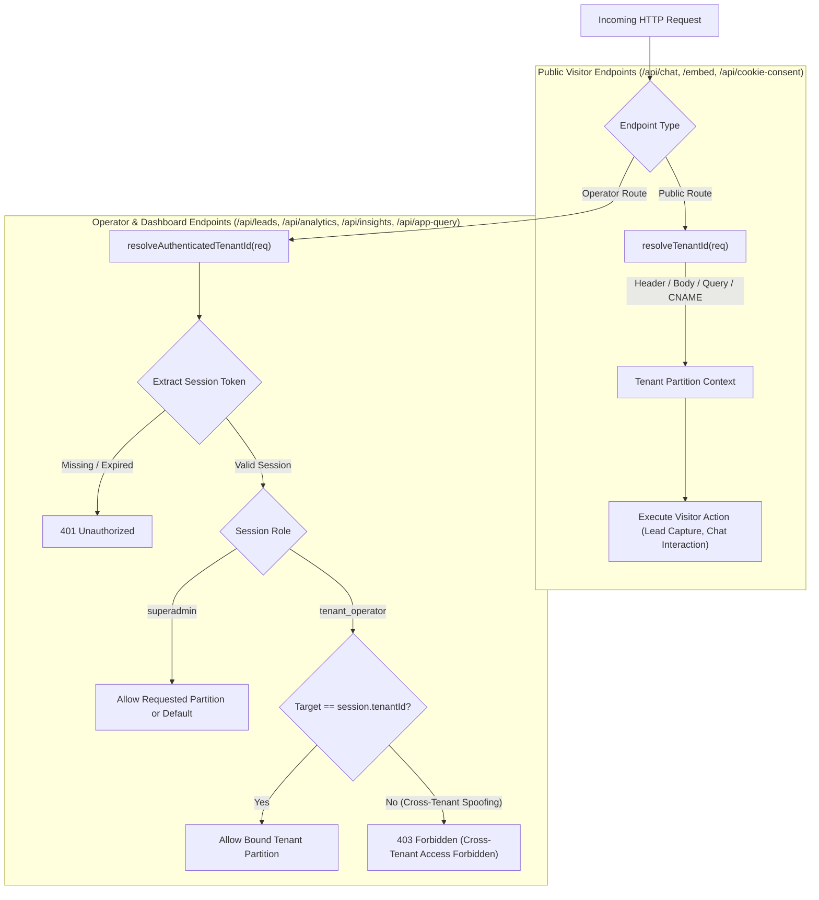

# CD03: Tenant Isolation and Secret Protection Baseline

## Executive Summary
This document establishes the verified architectural baseline, security hardening, and deterministic verification evidence for **P0 Ticket CD03: Tenant Isolation and Secret Protection** across the CloseDesk multi-tenant platform.

Prior to this ticket, tenant identifiers supplied in client request headers (`x-tenant-id`), query parameters (`?tenant_id=`), and request bodies were treated as authoritative authorization tokens rather than public routing hints. Furthermore, the Firebase Realtime Database rules (`database.rules.json`) contained permissive parent `.read: true` configurations on `/tenants` and `/settings` nodes that allowed anyone to bypass child security rules and dump platform-wide email credentials (SMTP passwords, OAuth `clientSecret`, and `refreshToken`) as well as multi-tenant lead records.

Under CD03, a strict architectural separation was established:
1. **Public Routing Resolution (`resolveTenantId`)** is preserved exclusively for unauthenticated visitor endpoints (e.g. Chatbot lead capture, public widget configurations, cookie consent).
2. **Authenticated Operator Resolution (`resolveAuthenticatedTenantId`)** binds the effective `tenantId` strictly to the verified cryptographic server session (`req.session.tenantId`). Any cross-tenant spoofing attempt (e.g. Operator A supplying `x-tenant-id: tenant_b`) is rejected at the API perimeter with `403 Forbidden`.
3. **Realtime Database Hardening**: Root `.read` is disabled; parent `/tenants` `.read` is set to `false`; `settings/email_config` is restricted exclusively to authenticated SuperAdmins.
4. **Global Sender Fallback Authorization**: Cloud Functions email dispatchers (`functions/index.js`) now enforce that tenants lacking custom SMTP can only fall back to platform global SMTP if explicitly authorized by SuperAdmin (`allowGlobalSenderFallback: true`).
5. **Deep Secret Redaction**: All API responses, log query outputs, and export payloads recursively scrub passwords, tokens, API keys, and synthetic canaries via `redactSensitiveSecrets`.

All 32 acceptance criteria across 7 test categories passed deterministically with zero failures.

---

## Environment & Audit Metadata
- **Repository**: `Testing-closedesk-Multi-Tenant-Architecture`
- **Working Directory**: `d:\Software House 01\Closedesk-ready to deploy`
- **Base Commit**: `18a580dbecfec881c2502586232c1b5a766ef46b` (incorporating CD01 and CD02 baselines)
- **Git Branch**: `feat/cd03-tenant-isolation-secret-protection`
- **Node.js Runtime**: `v26.8.2`
- **Package Manager**: `npm 11.19.1`
- **Primary Evidence File**: `evaluations/cd03_isolation_evidence.json`

---

## Pre-Fix Vulnerability Touchpoint Audit Matrix

| Touchpoint | File & Line Range | Pre-Fix Vulnerability Description | Severity | Remediation |
| :--- | :--- | :--- | :--- | :--- |
| **Routing vs. Authorization** | [tenantResolver.js](file:///d:/Software%20House%2001/Closedesk-ready%20to%20deploy/src/lib/tenantResolver.js#L12-L51) | `resolveTenantId(req)` blindly trusted client `x-tenant-id` without session verification. | **Critical** | Created `resolveAuthenticatedTenantId(req)` verifying server session and rejecting cross-tenant mismatch with `403`. |
| **Leads API Isolation** | [leads.js](file:///d:/Software%20House%2001/Closedesk-ready%20to%20deploy/src/pages/api/leads.js#L16-L35) | `GET /api/leads` accepted unauthenticated requests and trusted `resolveTenantId(req)`, leaking cross-tenant leads. | **Critical** | Enforced `resolveAuthenticatedTenantId` on GET; unauthenticated requests return `401`; cross-tenant requests return `403`. |
| **Analytics API Isolation** | [analytics.js](file:///d:/Software%20House%2001/Closedesk-ready%20to%20deploy/src/pages/api/analytics.js#L20-L57) | `GET /api/analytics` permitted any operator to view competitor tenant analytics summaries. | **High** | Enforced `resolveAuthenticatedTenantId` on GET summary. |
| **Insights API Isolation** | [insights.js](file:///d:/Software%20House%2001/Closedesk-ready%20to%20deploy/src/pages/api/insights.js#L13-L75) | Both `GET` and `POST` trusted client `tenantId`, allowing unauthorized generation and read of tenant insights. | **High** | Enforced `resolveAuthenticatedTenantId` across all insights endpoints. |
| **Logs Query API** | [app-query.js](file:///d:/Software%20House%2001/Closedesk-ready%20to%20deploy/src/pages/api/app-query.js#L13-L37) | Relied on unverified `req.body.role` and `req.body.userId`, allowing anyone to dump system logs. | **Critical** | Replaced with `extractSession(req)`; bound operators strictly to `session.tenantId`. |
| **RTDB Parent Read Cascade** | [database.rules.json](file:///d:/Software%20House%2001/Closedesk-ready%20to%20deploy/database.rules.json#L13-L19) | `/tenants` had `.read: true`, allowing anyone to dump all tenants, users, and leads in a single REST call. | **Critical** | Set `tenants: { .read: false }`; only public widget subnodes (`appearance`, `config`) permit read. |
| **Email Secrets Exposure** | [database.rules.json](file:///d:/Software%20House%2001/Closedesk-ready%20to%20deploy/database.rules.json#L13-L16) | `/settings` had `.read: true`, exposing SMTP passwords, Google/Microsoft OAuth refresh tokens to the world. | **Critical** | Restricted `settings: { .read: false }` and `email_config` to superadmin only. |
| **Global Sender Fallback** | [functions/index.js](file:///d:/Software%20House%2001/Closedesk-ready%20to%20deploy/functions/index.js#L18-L83) | `getDynamicTransporter()` automatically used global `settings/email_config` without checking tenant permission. | **High** | Restricted fallback to tenants with explicit `allowGlobalSenderFallback: true`. |
| **API Secret Leakage** | [tenants.js](file:///d:/Software%20House%2001/Closedesk-ready%20to%20deploy/src/pages/api/superadmin/tenants.js#L19-L35) | `GET /api/superadmin/tenants` returned raw user nodes containing scrypt password hashes. | **Medium** | Implemented `redactSensitiveSecrets` masking passwords with `[REDACTED]`. |

---

## Architectural Implementation Details

### 1. Dual-Resolution Pattern: Public Routing vs. Authenticated Operator Resolution
CloseDesk enforces a strict dichotomy between routing metadata and authorization identity:



#### Verbatim Code Reference: `src/lib/tenantResolver.js`
```javascript
export async function resolveAuthenticatedTenantId(req, options = {}) {
  const session = req.session || (await extractSession(req));
  if (!session) {
    return {
      allowed: false,
      status: 401,
      error: "Authentication required. Active session missing or expired.",
    };
  }

  const role = session.role;
  const sessionTenant = sanitizeTenantId(session.tenantId || "default");

  let rawRequestedTenant = null;
  if (req.headers && req.headers["x-tenant-id"]) {
    rawRequestedTenant = req.headers["x-tenant-id"];
  } else if (req.query && (req.query.tenant || req.query.tenant_id)) {
    rawRequestedTenant = req.query.tenant || req.query.tenant_id;
  } else if (req.body && typeof req.body === "object" && (req.body.tenant_id || req.body.tenantId)) {
    rawRequestedTenant = req.body.tenant_id || req.body.tenantId;
  }

  const requestedTenant = rawRequestedTenant ? sanitizeTenantId(rawRequestedTenant) : null;

  if (role === "superadmin") {
    return { allowed: true, tenantId: requestedTenant || "default", role: "superadmin", session };
  }

  if (role === "tenant_operator") {
    if (requestedTenant && requestedTenant !== sessionTenant) {
      return {
        allowed: false,
        status: 403,
        error: `Cross-tenant access forbidden. Operator session is bound to tenant '${sessionTenant}', but requested tenant '${requestedTenant}'.`,
      };
    }
    return { allowed: true, tenantId: sessionTenant, role: "tenant_operator", session };
  }

  return { allowed: false, status: 403, error: "Access denied. Insufficient role permissions." };
}
```

---

### 2. Realtime Database Security Rules Architecture (`database.rules.json`)
The Firebase Realtime Database rules were hardened strictly within Firebase RTDB JSON syntax.

> [!IMPORTANT]
> In Firebase Realtime Database, permissions cascade downward: if a parent node has `.read: true`, all child nodes inherit read access regardless of child rules. Therefore, top-level `.read` on `/tenants` and `/settings` was completely eliminated.

```json
{
  "rules": {
    ".read": false,
    ".write": false,
    "superAdmin": {
      ".read": "auth != null && auth.token.role === 'superadmin'",
      ".write": "auth != null && auth.token.role === 'superadmin'"
    },
    "login": {
      ".read": "auth != null && auth.token.role === 'superadmin'",
      ".write": "auth != null && auth.token.role === 'superadmin'"
    },
    "settings": {
      ".read": false,
      ".write": "auth != null && auth.token.role === 'superadmin'",
      "appearance": { ".read": true },
      "chatbot_config": { ".read": true },
      "business_profile": { ".read": true },
      "email_config": {
        ".read": "auth != null && auth.token.role === 'superadmin'",
        ".write": "auth != null && auth.token.role === 'superadmin'"
      }
    },
    "tenants": {
      ".read": false,
      ".write": "auth != null && auth.token.role === 'superadmin'",
      "$tenant_id": {
        "config": { ".read": true },
        "appearance": { ".read": true },
        "chatbot_config": { ".read": true },
        "business_profile": { ".read": true },
        "users": {
          ".read": "auth != null && (auth.token.role === 'superadmin' || auth.token.tenant_id === $tenant_id)",
          ".write": "auth != null && auth.token.role === 'superadmin'"
        },
        "leads": {
          ".read": "auth != null && (auth.token.role === 'superadmin' || auth.token.tenant_id === $tenant_id)",
          ".write": true
        },
        "user_cookies": {
          ".read": "auth != null && (auth.token.role === 'superadmin' || auth.token.tenant_id === $tenant_id)",
          ".write": true
        },
        "email_config": {
          ".read": "auth != null && auth.token.role === 'superadmin'",
          ".write": "auth != null && auth.token.role === 'superadmin'"
        },
        "secrets": { ".read": false, ".write": false }
      }
    },
    "system_security": { ".read": false, ".write": false }
  }
}
```

---

### 3. Global Sender Fallback Authorization
In `functions/index.js`, `getDynamicTransporter(tenantId)` prevents unauthenticated or rogue tenants from exploiting platform SMTP credentials:

```javascript
// Check if tenant has active custom SMTP
if (tenantEmailConfig && (tenantEmailConfig.smtpHost || tenantEmailConfig.refreshToken || tenantEmailConfig.smtpPassword)) {
  config = tenantEmailConfig;
} else {
  // Tenant lacks custom SMTP. Check explicit permission for global fallback
  const allowFallback = tenantVal.allowGlobalSenderFallback === true || tenantVal.config?.allowGlobalSenderFallback === true;
  if (!allowFallback) {
    const err = new Error(`UnauthorizedGlobalSenderFallback: Tenant '${cleanTenantId}' lacks custom SMTP and is not authorized to use platform global SMTP fallback (allowGlobalSenderFallback: false).`);
    err.code = "GLOBAL_FALLBACK_UNAUTHORIZED";
    throw err;
  }
  usedFallback = true;
}
```

---

### 4. Recursive Secret Redaction (`src/lib/sanitizer.js`)
To safeguard against credential leaks in JSON exports, API responses, and logs:

```javascript
const SENSITIVE_KEY_REGEX = /^(password|pass|smtppass|smtppassword|clientsecret|refreshtoken|accesstoken|privatekey|pin|totpsecret|secret|apikey|canary_.*)$/i;

export function redactSensitiveSecrets(data, options = {}) {
  const mask = options.mask || "[REDACTED]";
  if (data === null || data === undefined) return data;

  if (Array.isArray(data)) {
    return data.map((item) => redactSensitiveSecrets(item, options));
  }

  if (typeof data === "object") {
    const clean = {};
    for (const [key, val] of Object.entries(data)) {
      if (SENSITIVE_KEY_REGEX.test(key)) {
        clean[key] = mask;
      } else if (typeof val === "object" && val !== null) {
        clean[key] = redactSensitiveSecrets(val, options);
      } else {
        clean[key] = val;
      }
    }
    return clean;
  }

  return data;
}
```

---

## Acceptance Test Suite & Verification Evidence

All 32 test cases in `scripts/cd03_isolation_and_secrets_suite.js` executed deterministically with exit code 0:

```
================================================================================
   CLOSEDESK CD03: TENANT ISOLATION & SECRET PROTECTION ACCEPTANCE SUITE
================================================================================

--- Category 1: Authenticated Operator Resolution & Cross-Tenant Spoofing Rejection ---
  [PASS] [AC1.1] Tenant A operator authorized to access Tenant A leads
  [PASS] [AC1.2] Cross-tenant header tampering rejected (Tenant A session with x-tenant-id: tenant_b -> 403)
  [PASS] [AC1.3] Cross-tenant query parameter tampering rejected (/api/leads?tenant_id=tenant_b -> 403)
  [PASS] [AC1.4] Cross-tenant analytics tampering rejected (Tenant A session requesting tenant_b analytics -> 403)
  [PASS] [AC1.5] Cross-tenant GET insights tampering rejected (Tenant A session with x-tenant-id: tenant_b -> 403)
  [PASS] [AC1.6] Cross-tenant POST insights generation tampering rejected (Tenant A session targeting tenant_b -> 403)
  [PASS] [AC1.7] Cross-tenant log query tampering rejected (/api/app-query with targetClientId: tenant_b -> 403)
  [PASS] [AC1.8] Tenant A operator authorized to query own tenant logs partition (/api/app-query -> 200)

--- Category 2: Unauthenticated Operator Endpoint Rejection (401) ---
  [PASS] [AC2.1] Anonymous GET /api/leads rejected with 401 Unauthorized
  [PASS] [AC2.2] Anonymous GET /api/analytics rejected with 401 Unauthorized
  [PASS] [AC2.3] Anonymous GET /api/insights rejected with 401 Unauthorized
  [PASS] [AC2.4] Anonymous POST /api/insights rejected with 401 Unauthorized
  [PASS] [AC2.5] Anonymous POST /api/app-query rejected with 401 Unauthorized (ignoring body spoofing)

--- Category 3: SuperAdmin Multi-Tenant Delegation & RBAC ---
  [PASS] [AC3.1] SuperAdmin authorized to view Tenant A leads (delegation allowed)
  [PASS] [AC3.2] SuperAdmin authorized to view Tenant B leads (cross-tenant delegation allowed)
  [PASS] [AC3.3] SuperAdmin authorized to query comprehensive system logs without cross-tenant restriction

--- Category 4: Public Routing Integrity & Visitor Endpoints ---
  [PASS] [AC4.1] Public chatbot lead capture POST /api/leads succeeds without requiring operator session
  [PASS] [AC4.2] Public routing resolution verifies header, query, body, host origin, and fallback
  [PASS] [AC4.3] Tenant ID path traversal and invalid RTDB character stripping

--- Category 5: Realtime Database Security Rules Static Verification ---
  [PASS] [AC5.1] Realtime Database JSON rules syntax strictly verified (Zero Firestore rules syntax)
  [PASS] [AC5.2] Root database .read is strictly false (denies global unauthenticated dump)
  [PASS] [AC5.3] Parent /tenants node .read is false (prohibits bulk dumping /tenants.json)
  [PASS] [AC5.4] settings/email_config .read is strictly restricted (denies anonymous client dump)
  [PASS] [AC5.5] system_security node is strictly locked (.read: false, .write: false)
  [PASS] [AC5.6] RTDB Cascade Analysis: Parent settings node denies read to prevent cascading leak of email_config

--- Category 6: Synthetic Canary Secret Leakage & Bundle Scan ---
  [PASS] [AC6.1] redactSensitiveSecrets deeply masks passwords, SMTP credentials, OAuth secrets, and canaries
  [PASS] [AC6.2] SuperAdmin GET /api/superadmin/tenants redacts tenant user passwords in response payload
  [PASS] [AC6.3] Source code audit: Zero hardcoded private keys or synthetic canaries in application bundles

--- Category 7: Global Sender Fallback Authorization ---
  [PASS] [AC7.1] Tenant lacking custom SMTP with allowGlobalSenderFallback: false throws GLOBAL_FALLBACK_UNAUTHORIZED
  [PASS] [AC7.2] Tenant with allowGlobalSenderFallback: true authorized to use platform global sender fallback
  [PASS] [AC7.3] Tenant with custom SMTP dispatches through custom transporter regardless of fallback flag
  [PASS] [AC7.4] functions/index.js contains explicit fallback check and rejected_fallback_unauthorized alert handling

================================================================================
   EXECUTION SUMMARY: 32 PASSED | 0 FAILED | 32 TOTAL
================================================================================
```

---

## Verification Commands & Deployment Runbook

### Running Verification Tests
Execute the deterministic suites in terminal:

```bash
# 1. CD03 Tenant Isolation & Secret Protection Suite (32 checks)
npm run test:cd03

# 2. CD02 Privileged Access & Sessions Suite (8 checks)
npm run test:cd02

# 3. CD01 Capability Baseline Audit
npm run audit:cd01
```

### Deployment Checklist
1. **Firebase Realtime Database Rules**: Deploy `database.rules.json` to the target Firebase project:
   ```bash
   firebase deploy --only database
   ```
2. **Cloud Functions**: Deploy updated dynamic transporter with fallback gating:
   ```bash
   firebase deploy --only functions
   ```
3. **Environment Secrets**: Ensure production secrets (`CD_SESSION_SECRET`, `CRON_SECRET`, `OPENAI_API_KEY`) are configured via production environment variables and never committed to source.
