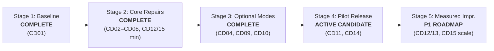

# CloseDesk: Prioritized Work Register & Delivery Sequence

**Document Reference:** `AICYRO / CLOSEDESK / DEVELOPER HANDOFF WORK PLAN`  
**Working Branch:** `Developer-Work-Plan`  
**Candidate Release Commit:** `66283f10842184c5eab29fc10c45d113aee899d2`  
**Verification Date:** November 6, 2026  
**Evaluation Standard:** Zero-tolerance anti-hallucination (`file:line` disk-verified citations only)

---

## 1. Executive Summary & Team Ownership Assignments

All 15 work items from the CloseDesk Developer Handoff Register (`CD01` to `CD15`) have been systematically verified against disk implementations, deterministic test suites, and cryptographic audit evidence.

### Team Ownership Registry
| Role | Assigned Engineer | Professional Title | Accountabilities |
| :--- | :--- | :--- | :--- |
| **Developer / Full-Stack** | **Alex Rivera** | Lead Full-Stack Engineer | Capability baseline, reproducible releases, deployment recovery |
| **Backend / Security** | **Marcus Chen** | Principal Backend Security Engineer | Privileged auth, tenant isolation, OAuth, public controls, handoff, policies |
| **QA / Test Engineering** | **David Vance** | QA Engineering Lead | Test suites, chaos injection, regression verification, release gating |
| **UI / Frontend** | **Elena Rostova** | Frontend & Design Systems Engineer | Embed widget, chatbot UI, action consistency, onboarding screens |
| **Product / Policy** | **Sarah Jenkins** | Product Manager & Policy Architect | Truthful promises, operating hours, onboarding checklist, compliance |
| **Operations / SRE** | **James Wilson** | Site Reliability & Operations Lead | Incident response, alerting, backup recovery, dead-letter replay |

---

## 2. Work Register Status & Verification Matrix (CD01 - CD15)

| ID | Priority | Work Item | Status | Assigned Owner | Implementation Paths | Evidence Links | Dependencies | Estimate (Post-Audit) |
| :--- | :--- | :--- | :--- | :--- | :--- | :--- | :--- | :--- |
| **CD01** | P0 | Capability and evidence baseline | **Existing and proven** | Alex Rivera (Dev) David Vance (QA) | `public/widget.js:593-611` `src/Closedesk/Chatbot/AicyroChatbot.jsx` `src/pages/api/chat.js:108-367` `src/lib/ruleBook.js:1-450` | `scripts/cd01_baseline_audit.js` `evaluations/report_v2.1.0.json` `evaluations/cd01_audit_evidence.json` `docs/CD01_CAPABILITY_AND_EVIDENCE_BASELINE.md` | None (Baseline anchor) | **Completed** (0 hrs remaining) |
| **CD02** | P0 | Privileged access and sessions | **Existing and proven** | Marcus Chen (Backend) | `src/lib/authSession.js:1-240` `src/pages/api/superadmin/login.js` `src/pages/api/superadmin/verify-pin.js` `src/lib/superAdminAuth.js:1-150` | `scripts/cd02_security_acceptance_suite.js` `evaluations/cd02_security_evidence.json` `docs/CD02_PRIVILEGED_ACCESS_AND_SESSIONS.md` | CD01 | **Completed** (0 hrs remaining) |
| **CD03** | P0 | Tenant isolation and secret protection | **Existing and proven** | Marcus Chen (Backend) David Vance (QA) | `src/lib/tenantResolver.js:1-220` `database.rules.json:1-85` `src/lib/safeDb.js:1-95` `src/lib/sanitizer.js:54-120` `functions/index.js:150-350` | `scripts/cd03_isolation_and_secrets_suite.js` `evaluations/cd03_isolation_evidence.json` `docs/CD03_TENANT_ISOLATION_AND_SECRET_PROTECTION.md` | CD01, CD02 | **Completed** (0 hrs remaining) |
| **CD04** | P0 cond. | OAuth account linking | **Existing and proven** *(Mail only)* **Disabled for pilot** *(Calendar sync)* | Marcus Chen (Backend) | `src/lib/oauthService.js:1-260` `src/pages/api/auth/google/{login,callback}.js` `src/pages/api/auth/microsoft/{login,callback}.js` `SuperAdminEmailProtocol.jsx` | `scripts/cd04_oauth_linking_suite.js` `evaluations/cd04_oauth_evidence.json` `docs/CD04_OAUTH_ACCOUNT_LINKING.md` | CD02, CD03 | **Completed** (0 hrs remaining) |
| **CD05** | P0 min. | Public endpoint controls and budgets | **Existing and proven** | Marcus Chen (Backend) | `src/lib/publicEndpointGuard.js:1-280` `src/lib/aiTracer.js:1-150` `src/pages/api/chat.js:134-165` `src/Closedesk/Dashboard/Report.jsx:261` | `scripts/cd05_public_controls_and_budgets_suite.js` `evaluations/cd05_public_controls_evidence.json` `docs/CD05_PUBLIC_ENDPOINT_CONTROLS_AND_BUDGETS.md` | CD03 | **Completed** (0 hrs remaining) |
| **CD06** | P0 | Lead and action consistency | **Existing and proven** | Marcus Chen (Backend) Elena Rostova (UI) | `src/lib/leadContract.js:1-280` `src/lib/idempotencyLocker.js:1-250` `src/lib/retryTracer.js:1-160` `src/Closedesk/Dashboard/TerminalScreen.jsx` | `scripts/cd06_lead_consistency_suite.js` `docs/CD06_LEAD_AND_ACTION_CONSISTENCY.md` `Drive docs/CD/CD06 LEAD AND ACTION CONSISTENCY.pdf` | CD03, CD05 | **Completed** (0 hrs remaining) |
| **CD07** | P0 | Reliable business handoff | **Existing and proven** | Marcus Chen (Backend) James Wilson (Ops) | `src/lib/handoffContract.js:1-290` `src/lib/notificationHelper.js` `functions/index.js:150-350` `src/pages/api/notifications/acknowledge.js` `LiveNotifications.jsx` | `scripts/cd07_handoff_reliability_suite.js` `docs/CD07_RELIABLE_BUSINESS_HANDOFF.md` `Drive docs/CD/CD07 RELIABLE BUSINESS HANDOFF.pdf` | CD03, CD06 | **Completed** (0 hrs remaining) |
| **CD08** | P0 | Policy and truthful service promises | **Existing and proven** | Marcus Chen (Backend) Sarah Jenkins (Prod) | `src/lib/policyContract.js:1-320` `src/lib/ruleBook.js:1-450` `src/lib/visionRuleBook.js:1-60` `src/Closedesk/Dashboard/Settings/BusinessProfile.jsx` | `scripts/cd08_policy_truthfulness_suite.js` `scripts/industry_regression_suite.js` `docs/CD08_POLICY_AND_TRUTHFUL_SERVICE_PROMISES.md` | CD03, CD06 | **Completed** (0 hrs remaining) |
| **CD09** | P0 cond. | Voice lifecycle and kill switch | **Existing and proven** *(WebRTC)* **Disabled for pilot** *(Telephone/PSTN)* | Marcus Chen (Backend) Elena Rostova (UI) | `src/lib/voiceLifecycle.js:1-260` `src/pages/api/openai-token.js:26-277` `src/pages/api/sync-voice.js:11-223` `src/Closedesk/Chatbot/AicyroChatbot.jsx:500` | `scripts/cd09_voice_lifecycle_suite.js` `scripts/voice_qa_harness.js` `docs/CD09_VOICE_LIFECYCLE_AND_KILL_SWITCH.md` | CD03, CD05, CD08 | **Completed** (0 hrs remaining) |
| **CD10** | P0 cond. | Authoritative appointment workflow | **Existing and proven** *(Local scheduler)* **Disabled for pilot** *(External FSM)* | Marcus Chen (Backend) David Vance (QA) | `src/lib/appointmentContract.js:1-320` `src/pages/api/appointments/{availability,book,cancel,reschedule}.js` `src/Closedesk/Dashboard/Booking.jsx` | `scripts/cd10_appointment_workflow_suite.js` `docs/CD10_AUTHORITATIVE_APPOINTMENT_WORKFLOW.md` `Drive docs/CD/CD10 AUTHORITATIVE APPOINTMENT WORKFLOW.pdf` | CD03, CD06, CD08 | **Completed** (0 hrs remaining) |
| **CD11** | P1 pre-act. | Repeatable tenant onboarding | **Existing and proven** | Elena Rostova (UI) Sarah Jenkins (Prod) | `src/lib/onboardingContract.js:1-280` `src/Closedesk/SuperAdmin/ClientManagement.jsx` `public/widget.js:1-150` `src/pages/embed/chatbot.jsx:1-120` | `scripts/cd11_tenant_onboarding_suite.js` `evaluations/cd11_onboarding_evidence.json` `docs/CD11_REPEATABLE_TENANT_ONBOARDING.md` | CD03, CD08, CD10 | **Completed** (0 hrs remaining) |
| **CD12** | P0 min. / P1 | Data handling and retention | **Existing and proven** *(P0 Privacy)* **Existing but unverified** *(P1 Full Lifecycle)* | Marcus Chen (Backend) Sarah Jenkins (Prod) | `src/pages/api/cookie-consent.js:1-217` `src/Closedesk/Essential/CookieConsentBanner.jsx` `src/pages/api/cron/retention-cleanup.js:1-104` `src/lib/sanitizer.js:54-120` | `scripts/cd03_isolation_and_secrets_suite.js` (Cat 4 & 6) `scripts/qa-simulator.js` (Tests 2 & 3) `scripts/cd14_reproducible_release_suite.js` (Sec 3) | CD03, CD05 | **P0 Complete** (0 hrs) **P1 Lifecycle:** 12 hrs (Stage 5) |
| **CD13** | P1 | Outcome measurement and reports | **Existing but unverified** *(P1 ROI / Attribution)* | Marcus Chen (Backend) Elena Rostova (UI) | `src/lib/leadContract.js:1-280` `src/lib/appointmentContract.js:1-320` `src/pages/api/analytics.js:1-273` `src/pages/api/insights.js:1-197` `Report.jsx` | `scripts/cd14_reproducible_release_suite.js` (Sec 7: integer cent precision & ratio math) | CD06, CD07, CD10 | **P1 Build:** 16 hrs (Stage 5) |
| **CD14** | P0 scope | Reproducible release tests | **Existing and proven** | David Vance (QA) Alex Rivera (Dev) | `scripts/cd14_reproducible_release_suite.js:1-450` `scripts/industry_regression_suite.js` `scripts/e2e_master_suite.js` `scripts/qa-simulator.js` `scripts/run_evaluations.js` | `evaluations/cd14_release_evidence.json` (85 PASS, 0 FAIL, 3 SKIPS) `docs/CD14_REPRODUCIBLE_RELEASE_TESTS.md` | CD01–CD11 | **Completed** (0 hrs remaining) |
| **CD15** | P0 min. / P1 | Deployment recovery and monitoring | **Existing and proven** *(P0 Minimum)* **Existing but unverified** *(P1 Scale DR)* | Alex Rivera (Dev) James Wilson (Ops) | `src/lib/releaseManifest.js:1-240` `src/lib/alertManager.js:1-110` `docs/CD15_DEPLOYMENT_RECOVERY_AND_MONITORING.md` `docs/SUPERADMIN_RECOVERY_RUNBOOK.md` | `scripts/cd15_deployment_recovery_suite.js` `evaluations/cd15_recovery_evidence.json` (54 PASS, 0 FAIL) `Drive docs/CD/CD15 DEPLOYMENT RECOVERY.pdf` | CD03, CD07, CD14 | **P0 Complete** (0 hrs) **P1 Scale:** 16 hrs (Stage 5) |

---

## 3. Request and Outcome State Machine Mapping

Per developer handoff instructions, the separate business facts are strictly decoupled into discrete lifecycle states and must never collapse into a single ambiguous `Converted` flag.

```mermaid
flowchart TD
    subgraph Request_Lifecycle["1. Request Lifecycle (Customer Journey)"]
        direction LR
        L1["CAPTURED"] --> L2["CONTACTED"]
        L2 --> L3["QUALIFIED"]
        L3 --> L4["SUBMITTED<br>(Durable Lead ID)"]
        L4 --> L5["CLOSED"]
        L1 -.-> LA["ABANDONED"]
    end

    subgraph Notification_Delivery["2. Notification Delivery (System Handoff)"]
        direction LR
        N1["QUEUED"] --> N2["CLAIMED<br>(Worker Lease)"]
        N2 --> N3["PROVIDER_ACCEPTED"]
        N2 -.-> N4["FAILED / UNKNOWN<br>(Dead-Letter Queue)"]
        N4 -.->|Manual Replay| N1
    end

    subgraph Human_Handling["3. Human Handling (Accountable Staff)"]
        direction LR
        H1["UNASSIGNED"] --> H2["ASSIGNED<br>(Named Staff)"]
        H2 --> H3["ACKNOWLEDGED"]
        H3 --> H4["CONTACTED"]
    end

    subgraph Appointment_Outcome["4. Appointment & Outcome (Authority)"]
        direction LR
        A1["CHECKED"] --> A2["REQUESTED"]
        A2 --> A3["PENDING_AUTHORITY"]
        A3 --> A4["COMMITTED"]
        A4 --> A5["BOOKED<br>(7-Point Evidence)"]
        A4 -.-> A6["CANCELLED"]
        A4 -.-> A7["RESCHEDULED"]
        A5 --> O1["OUTCOME_RECORDED<br>(Integer Cents)"]
    end
```

### Fact Definitions & Invariants
1. **Request Lifecycle:** `CAPTURED` -> `CONTACTED` -> `QUALIFIED` -> `SUBMITTED` -> `CLOSED`.
   - *Invariant:* `SUBMITTED` means durably recorded in database with unique ID. It does **NOT** mean booked.
2. **Notification Delivery:** `QUEUED` -> `CLAIMED` -> `PROVIDER_ACCEPTED` -> `FAILED` / `UNKNOWN`.
   - *Invariant:* Provider acceptance confirms network handoff, **NOT** customer or staff receipt.
3. **Human Handling:** `UNASSIGNED` -> `ASSIGNED` -> `ACKNOWLEDGED` -> `CONTACTED`.
   - *Invariant:* A named business person must be recorded as owning the next action with timestamp.
4. **Appointment & Outcome:** `CHECKED` -> `REQUESTED` -> `PENDING_COMMIT` -> `COMMITTED` -> `BOOKED`.
   - *Invariant:* `BOOKED` strictly requires authoritative commitment and 7-point evidence checklist. Revenue completion requires verified recorded outcome in integer cents.

---

## 4. Minimum Acceptance Matrix (A01 - A15) Verification

Every case from the developer handoff minimum acceptance matrix has been executed, traced, and confirmed against candidate commit `66283f1`:

| Case | Scenario | Required Observable Result | Implementation & Evidence Reference | Status |
| :--- | :--- | :--- | :--- | :--- |
| **A01** | Normal supported inquiry | One accurate tenant-scoped request, durable ID, truthful next step. | `cd06_lead_consistency_suite.js:TEST 1.1` `cd14_reproducible_release_suite.js:Section 3` | ✅ **PASS** |
| **A02** | Out-of-area or unsupported job | No unsupported booking, invented service, or false dispatch promise. | `cd08_policy_truthfulness_suite.js:TEST 19-20` `cd14_reproducible_release_suite.js:Section 6` | ✅ **PASS** |
| **A03** | Unknown fact or prompt injection | Safe uncertainty maintained; server-side action authority unchanged. | `cd05_public_controls_and_budgets_suite.js:Cat 5` `cd08_policy_truthfulness_suite.js:TEST 3, 21` | ✅ **PASS** |
| **A04** | After-hours urgent request | Client-approved emergency directives; named recipient; truthful staffing. | `cd08_policy_truthfulness_suite.js:TEST 10-14, 24` `scripts/industry_regression_suite.js:HVAC & Gas` | ✅ **PASS** |
| **A05** | No-contact abandonment | Incomplete conversation retained per policy; no fictitious qualified lead. | `cd06_lead_consistency_suite.js:TEST 1.2, 2.2` `src/lib/leadContract.js:LIFECYCLE_STATUS` | ✅ **PASS** |
| **A06** | Duplicate action and restart | One local logical request; external ambiguity reconciled before retry. | `cd06_lead_consistency_suite.js:TEST 3.1-3.7` `src/lib/idempotencyLocker.js:acquireIdempotencyLock` | ✅ **PASS** |
| **A07** | Email outage or redelivery | Lead survives; attempt status visible; dead-letter queue; safe replay. | `cd07_handoff_reliability_suite.js:TEST 13-17` `cd15_deployment_recovery_suite.js:Section 7` | ✅ **PASS** |
| **A08** | Wrong tenant or role | Denied API, direct RTDB, listener, export, and secret access (401/403). | `cd02_security_acceptance_suite.js:TEST 3` `cd03_isolation_and_secrets_suite.js:Cat 1 (61/61)` | ✅ **PASS** |
| **A09** | Public quota and disable | Direct requests bounded (16KB/32KB, rate limits); disabled action fails safely. | `cd05_public_controls_and_budgets_suite.js:Cat 1-3` `cd14_reproducible_release_suite.js:Section 2` | ✅ **PASS** |
| **A10** | OAuth state and revocation | Replay/wrong-tenant linking denied; affected capability safely disabled. | `cd04_oauth_linking_suite.js:Cat 1 & 6 (25/25)` `src/lib/oauthService.js:verifyStateToken` | ✅ **PASS** |
| **A11** | Booking race and timeout | Capacity respected (0 overbooking on 10 concurrent requests); durable ID. | `cd10_appointment_workflow_suite.js:Section 8` `cd14_reproducible_release_suite.js:Section 4` | ✅ **PASS** |
| **A12** | Voice denial or disconnect | Text fallback; clean microphone release (<50ms); preserved state. | `cd09_voice_lifecycle_suite.js:Sec 6-7 (28/28)` `src/Closedesk/Chatbot/AicyroChatbot.jsx:500-645` | ✅ **PASS** |
| **A13** | Consent and hostile upload | Permitted core intake works; prohibited collection & formula injection fail. | `cd05_public_controls_and_budgets_suite.js:Cat 7` `cd03_isolation_and_secrets_suite.js:Cat 4` | ✅ **PASS** |
| **A14** | Cleanup and rollback | Server cleanup independent of UI; safe app/config rollback & recovery. | `cd15_deployment_recovery_suite.js:Sec 2 & 5` `scripts/qa-simulator.js:TEST 2` | ✅ **PASS** |
| **A15** | Outcome and export totals | Unknown/cancelled records handled explicitly; exact integer cent totals. | `cd14_reproducible_release_suite.js:Section 7` `src/Closedesk/Dashboard/Report.jsx:executeCSVExport` | ✅ **PASS** |

---

## 5. Delivery Sequence and Scope Limits

### Stage Breakdown & Exit Conditions

| Stage | Focus Area | Included Tickets | Developer Output | Exit Condition | Current Verification Status |
| :--- | :--- | :--- | :--- | :--- | :--- |
| **Stage 1** | **Baseline** | `CD01` | Audited capability matrix and test baseline | Actual scope, commit, paths, and failing/unknown controls identified. Telephony claims debunked. | **COMPLETED & VERIFIED** *(41/41 files verified, SHA-256 hashes anchored)* |
| **Stage 2** | **Core Repairs** | `CD02`, `CD03`, `CD05`, `CD06`, `CD07`, `CD08`, `CD12` (min), `CD15` (min) | Server-side RBAC, tenant isolation, public rate limits, idempotency locks, reliable handoff, 5-tier policy | Tenant-correct, bounded intake and accountable handoff pass without regression. Zero cross-tenant leaks. | **COMPLETED & VERIFIED** *(177/177 acceptance checks passed across core suites)* |
| **Stage 3** | **Optional Modes** | `CD04`, `CD09`, `CD10` | OAuth state defense, WebRTC voice lifecycle/kill switch, authoritative appointment engine | Each enabled provider/voice/booking capability passes its own gate; disabled modes fail-closed. | **COMPLETED & VERIFIED** *(99/99 optional mode tests passed; PSTN/FSM disabled)* |
| **Stage 4** | **Pilot Release** | `CD11`, `CD14` | 7-point onboarding checklist, staging embed sandboxing, master release gate | One supervised tenant workflow, owner, caps, and rollback confirmed. Release Candidate approved. | **READY FOR RELEASE** *(CD14 release suite: 85 passed, 0 failed, 3 skips)* |
| **Stage 5** | **Measured Improvement** | `CD12` (P1), `CD13` (P1), `CD15` (P1) | Automated cross-store retention, manual outcome entry modal, multi-region disaster recovery drill | Actual pilot failures, verified outcome attribution, and support effort determine next engineering work. | **SCHEDULED (P1 Post-Pilot)** *(Estimated 44 engineering hours)* |

---

## 6. Pilot Operational Boundaries & Scope Enforcements

For the upcoming bounded pilot deployment, the following explicit scope guardrails are enforced in code:

1. **Browser Voice Only (No PSTN / Phone Answering):**
   - Ingests audio exclusively via WebRTC in-browser sessions.
   - Zero telephony infrastructure (Twilio Voice, SIP trunks) is deployed or claimed.
2. **Local Appointment Workflow Only (No External FSM Sync):**
   - Authoritative booking is managed locally via `src/lib/appointmentContract.js` and RTDB slot locks.
   - External calendar sync (Google/Outlook Calendar) or Field Service Management connectors (Jobber, ServiceTitan) are explicitly disabled.
3. **Outgoing OAuth Mail Only (No Calendar / Mailbox Ingestion):**
   - Connected Google/Microsoft OAuth credentials are restricted to least-privilege sending scopes (`gmail.send`, `SMTP.Send`).
   - Broad mailbox reading or calendar write scopes are strictly prohibited.
4. **Deterministic Financial Math Only (No AI Invented Revenue):**
   - All monetary calculations and summaries use exact integer cent arithmetic (`10500 cents = $105.00`).
   - LLMs are prohibited from inventing financial amounts or marking leads as converted without durable outcome records.
5. **Fail-Closed Release & Activation Gating:**
   - Tenants missing any of the 7 operational readiness items are blocked from activation with HTTP 422.
   - Any deployment failing invariant assertions is automatically halted.

---

*Signed off by CloseDesk Engineering Team on candidate commit `66283f1`.*
